# AgendaSalud — Documentación de la implementación

> Estado del código en la rama `feature/federico` (octubre 2026).
> Este documento explica **qué hay**, **dónde está**, **cómo funciona** y **qué falta revisar**.
> Complementa la preentrega (`docs/Desarrollo de Aplicaciones I-VI-NOCHE-TPO-Grupo nn Preentrega.md`).

---

## Índice

1. [Resumen](#1-resumen)
2. [Cómo compilar, probar y ejecutar](#2-cómo-compilar-probar-y-ejecutar)
3. [Pantallas y flujos](#3-pantallas-y-flujos)
4. [Arquitectura](#4-arquitectura)
5. [Estructura de carpetas y archivos](#5-estructura-de-carpetas-y-archivos)
6. [Modelo de datos (Room)](#6-modelo-de-datos-room)
7. [Reglas de negocio](#7-reglas-de-negocio)
8. [Seguridad y privacidad](#8-seguridad-y-privacidad)
9. [Trazabilidad con requisitos (RF / RNF)](#9-trazabilidad-con-requisitos-rf--rnf)
10. [Tests](#10-tests)
11. [Dependencias](#11-dependencias)
12. [Cambios respecto de la preentrega](#12-cambios-respecto-de-la-preentrega)
13. [Verificaciones pendientes](#13-verificaciones-pendientes)
14. [Sugerencias de mejora](#14-sugerencias-de-mejora)
15. [Guía rápida para el equipo](#15-guía-rápida-para-el-equipo)

---

## 1. Resumen

App Android nativa (Kotlin + Jetpack Compose) para que un profesional independiente de salud gestione **agenda, pacientes y cobros** desde el celular, **sin conexión** y con los datos **cifrados en el dispositivo** (modelo *local-first*).

**Lo que funciona hoy** (probado en emulador Android 14):

| Área | Qué se puede hacer |
|---|---|
| Acceso | Registrar el usuario la primera vez, ingresar con usuario y contraseña, ingresar con huella/PIN del celular (atajo opcional), cerrar sesión, bloqueo automático a los 2 minutos en segundo plano |
| Hoy | Ver turnos, huecos libres y bloqueos del día; saldos pendientes de los pacientes del día; dar turnos; completar, cobrar, reprogramar y cancelar |
| Agenda | Lo mismo que Hoy para cualquier día (flechas o selector de fecha) + bloquear y quitar períodos (vacaciones, cursos) |
| Pacientes | Buscar, ver saldo, alta, edición, ficha con historial y cancelaciones del año, desactivar y reactivar |
| Cobros | Lista de cargos pendientes o todos, total pendiente, registrar cobros totales o parciales (efectivo / Mercado Pago) |
| WhatsApp | Tras reprogramar, borrador editable para avisar al paciente: abrir WhatsApp o copiar el texto |

**Decisión de diseño principal:** son **5 pantallas** (Login + 4 pestañas). Todas las acciones (nuevo turno, cobro, reprogramar, ficha, etc.) se resuelven con **diálogos y paneles inferiores** dentro de esas pantallas, sin navegar a pantallas nuevas.

---

## 2. Cómo compilar, probar y ejecutar

### Requisitos

- Android Studio (cualquier versión reciente con AGP 9.x). Trae su propio JDK.
- Android SDK con **API 37** (Gradle la descarga sola la primera vez si falta).
- Gradle **9.5.0** (se baja solo vía `gradlew`).

### Desde Android Studio

1. Abrir la carpeta `TPO1_app` (no la raíz del repo).
2. Esperar el *Gradle sync*.
3. Elegir un dispositivo y tocar **Run ▶**.

### Desde la terminal (macOS)

```bash
cd TPO1_app
export JAVA_HOME="/Applications/Android Studio.app/Contents/jbr/Contents/Home"

./gradlew :app:assembleDebug            # genera app/build/outputs/apk/debug/app-debug.apk
./gradlew :app:testDebugUnitTest        # tests de reglas (sin Android, segundos)
./gradlew :app:lintDebug                # análisis estático
./gradlew :app:connectedDebugAndroidTest  # tests de base cifrada (requiere emulador o celular)
```

### Emulador en una compu con pocos recursos

En compus de bajo consumo (por ejemplo MacBook Air con i5 de 2 núcleos) el emulador estándar con Play Store **no llega a arrancar** (el sistema Android se cae por timeout). Lo que sí funcionó:

- AVD **"AgendaSalud Liviano"**: Android 14 (API 34) imagen *Google APIs* **sin Play Store**, 720×1600, 2 núcleos, 2 GB, sin cámaras/sensores, Quick Boot activado. Aparece en *Device Manager*.
- El primer arranque tarda ~10 minutos; después, con Quick Boot, arranca en segundos.
- **No compilar con Gradle mientras el emulador está corriendo** (compilar, cerrar Gradle con `./gradlew --stop`, recién ahí abrir el emulador).
- Alternativas sin emulador: un celular Android por USB, o *Device Streaming* (Android Studio → Device Manager → Firebase).

### Usuario de prueba

No hay usuario precargado: la primera vez se toca **Registrarse**. Para empezar de cero se borran los datos de la app (`adb shell pm clear ar.edu.fguerrero.da1.agendasalud`) — **esto borra todo, incluida la base**.

---

## 3. Pantallas y flujos

Capturas tomadas del emulador durante la prueba manual (`docs/capturas/`).

### 3.1 Login (wireframe 01)

| Con usuario creado | Sin usuario | Registro |
|---|---|---|
| 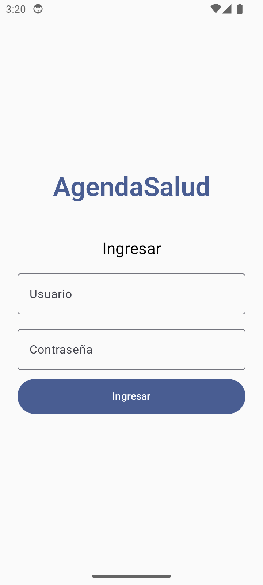 | 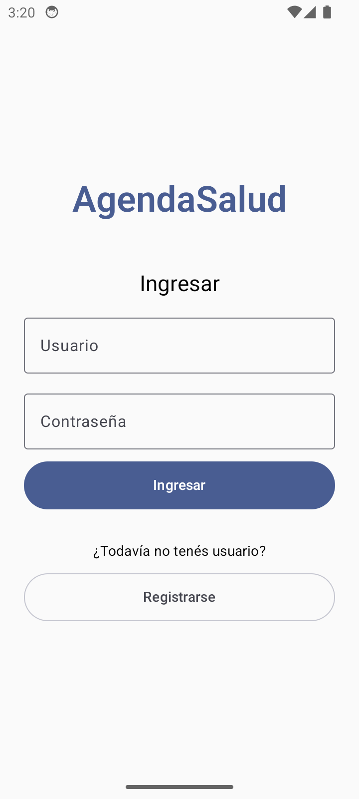 | 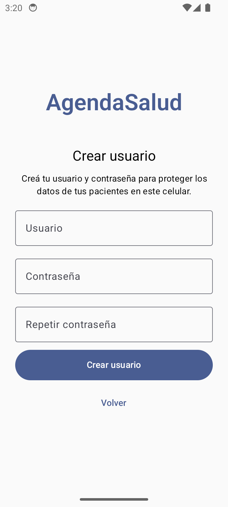 |

- Siempre se muestra primero **Ingresar** (usuario + contraseña).
- El botón **Registrarse** aparece **solo si todavía no hay usuario** en el celular (un único profesional por dispositivo).
- Si hay huella o PIN configurado en el celular, aparece **"Ingresar con huella o PIN"** como atajo. Si la huella falla se muestra el motivo; si el usuario cancela, no.
- Después del login se **abre la base cifrada** ("Abriendo tus datos…"). Si no se puede abrir (por ejemplo, Android invalidó la clave del Keystore al quitar el bloqueo de pantalla), en vez de cerrarse la app muestra **"No se pudieron abrir tus datos"** con *Reintentar*, *Empezar de cero* (borra todo, con confirmación) y *Cerrar sesión*.
- Archivos: `presentation/acceso/LoginScreen.kt`, `LoginViewModel.kt`, `AperturaBaseScreen.kt`, `core/security/Credenciales.kt`.

### 3.2 Hoy (wireframe 02)

| Turnos del día | Acciones de un turno | Cerrar sesión |
|---|---|---|
| 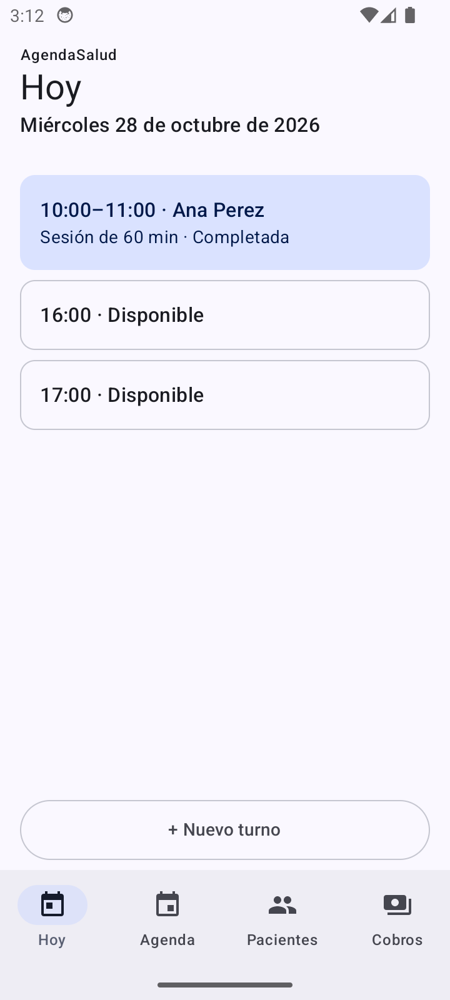 | 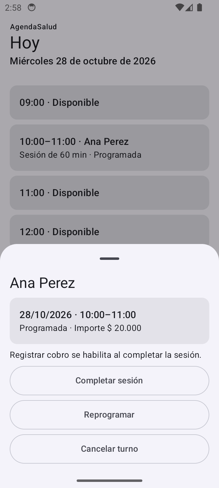 | 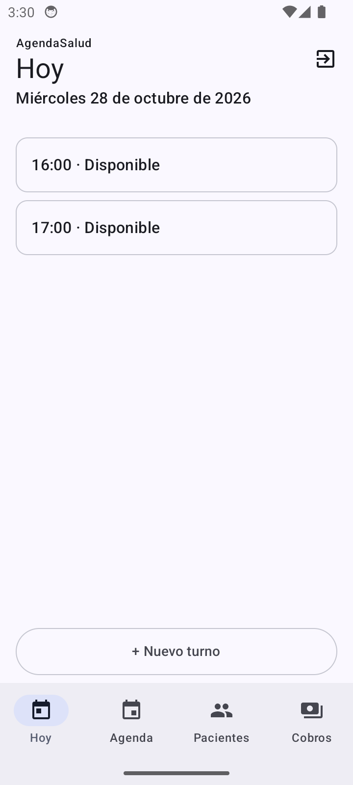 |

- Lista mezclada y ordenada por hora: **turnos** (azul), **huecos libres** (blanco con borde), **bloqueos** (rosa). El estado también se indica con texto, no solo con color (RNF05).
- No se ofrecen huecos que ya empezaron.
- Debajo: "Pendiente de *paciente*: $X" para los pacientes con turno ese día y saldo.
- **Tocar un hueco** → diálogo *Nuevo turno* con la hora precargada.
- **Tocar un turno** → panel con: Completar sesión, Reprogramar, Cancelar turno (si está programado) o Registrar cobro (si está completado).
- **Completar sesión** abre directamente *Registrar cobro* (flujo "Cobrar" de la preentrega).
- Botón **+ Nuevo turno** siempre visible abajo.
- Ícono **cerrar sesión** arriba a la derecha (en las 4 pestañas).
- Archivos: `presentation/turnos/AgendaDia.kt` (`HoyScreen`), `AgendaDiaViewModel.kt`, `TurnoDialogos.kt`.

### 3.3 Registrar cobro (wireframes 13–16)

| Cobro parcial | Error: monto mayor al pendiente |
|---|---|
| 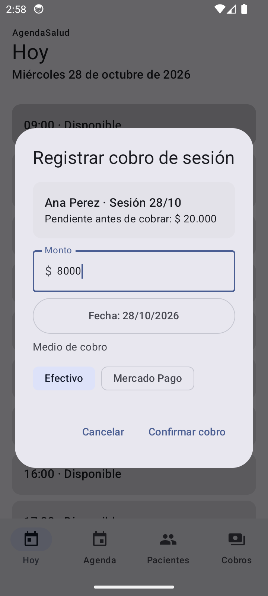 | 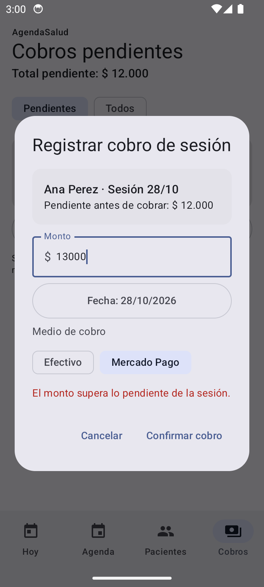 |

- Muestra paciente, fecha de sesión y pendiente. El monto viene precargado con el total pendiente.
- Fecha editable (hoy por defecto) y medio: **Efectivo** o **Mercado Pago**.
- Los errores se muestran **dentro del diálogo** y no se guarda nada (RNF07).
- Archivo: `presentation/pagos/RegistrarCobroDialog.kt` (lo usan Hoy, Agenda y Cobros).

### 3.4 Agenda del día (wireframe 03) y bloqueos (22–23)

| Agenda con bloqueo | Borrador de WhatsApp tras reprogramar |
|---|---|
| 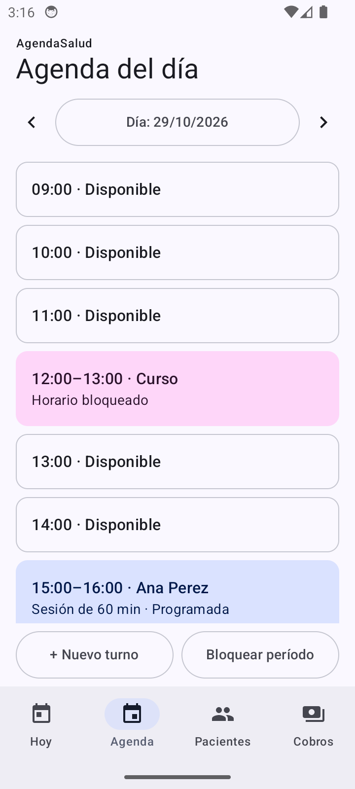 | 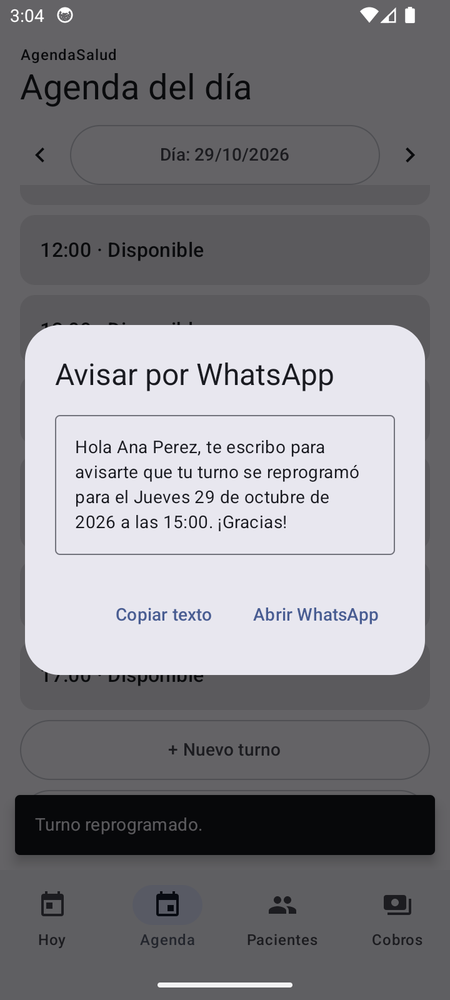 |

- Igual que Hoy, más: flechas **día anterior / siguiente** y botón de fecha (calendario).
- **Bloquear período**: desde (fecha + hora), hasta (fecha + hora) y motivo. No se puede bloquear encima de turnos programados ("Hay turnos programados en ese período…").
- Tocar un bloqueo → confirmar para **quitarlo**.
- **Reprogramar** → nueva fecha y hora → se guarda → aparece el **borrador de WhatsApp** (editable) con *Copiar texto*, *Abrir WhatsApp* y *Ahora no*. Nunca se envía solo.
- Domingos: "No hay atención este día".
- Archivos: `presentation/turnos/AgendaDia.kt` (`AgendaScreen`), `presentation/disponibilidad/BloquearPeriodoDialog.kt`, `TurnoDialogos.kt` (`WhatsAppDialog`).

### 3.5 Pacientes (wireframes 04–07, 30–31)

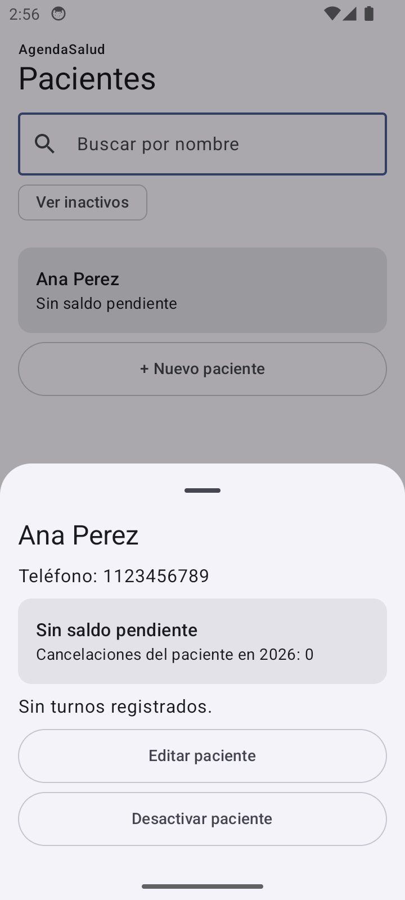

- Buscador por nombre, filtro **Ver inactivos**, saldo pendiente por paciente.
- **+ Nuevo paciente**: nombre (obligatorio) y teléfono (opcional, se usa para WhatsApp).
- Tocar un paciente → **ficha** (panel inferior): teléfono, saldo, cancelaciones del año, últimos 20 turnos, *Editar*, *Desactivar* (con confirmación) o *Reactivar*.
- Un paciente desactivado conserva su historial y no aparece para nuevos turnos.
- Archivos: `presentation/pacientes/PacientesScreen.kt`, `PacientesViewModel.kt`.

### 3.6 Cobros pendientes (wireframe 12)

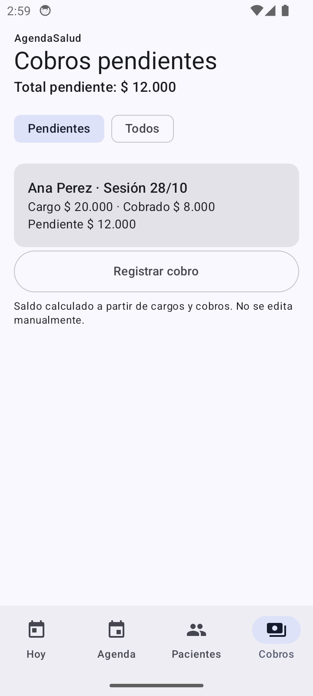

- Total pendiente arriba; filtro **Pendientes / Todos**.
- Cada cargo: paciente, sesión, cargo, cobrado y pendiente (o "Saldado") + botón **Registrar cobro**.
- Nota: "Saldo calculado a partir de cargos y cobros. No se edita manualmente."
- Archivos: `presentation/pagos/CobrosScreen.kt`, `CobrosViewModel.kt`.

### 3.7 Mapa de navegación

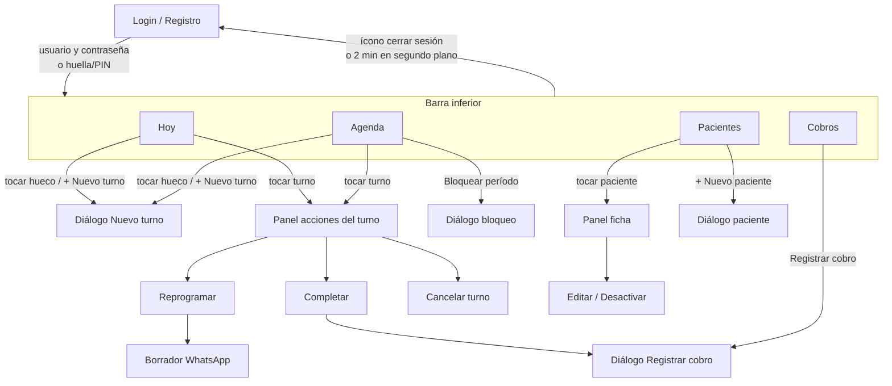

Rutas de Navigation Compose (tipadas, en `presentation/navegacion/Rutas.kt`): `RutaHoy`, `RutaAgenda`, `RutaPacientes`, `RutaCobros`. El Login no es una ruta: `MainActivity` muestra `LoginScreen` o el `NavHost` según `SesionSeguridad.desbloqueada`.

---

## 4. Arquitectura

MVVM + repositorios, en tres capas, como en la sección 13 de la preentrega.

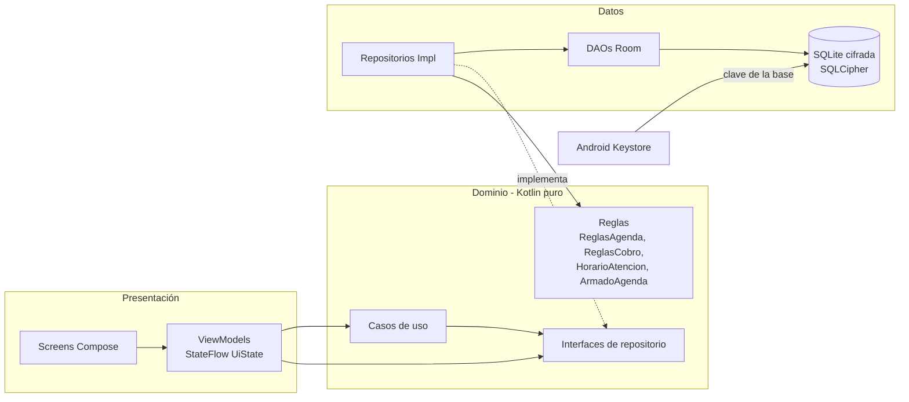

- **La UI nunca toca Room.** Los ViewModels usan interfaces de `domain/repository`.
- **El dominio no depende de Android ni de Compose**: las reglas se prueban con JUnit puro.
- **Lecturas**: Room → `Flow` → ViewModel (`combine`, `stateIn`) → `UiState` → Compose. Los cambios en la base se reflejan solos en todas las pantallas.
- **Escrituras**: ViewModel → caso de uso / repositorio → **transacción** (`AgendaDatabase.transaccion`) → `Resultado.Exito` o `Resultado.Fallo(ErrorDominio)`. El aviso de éxito (snackbar) solo se muestra **después** de una escritura confirmada.
- **Inyección de dependencias manual**: `AppContainer` (creado en `AgendaSaludApp`). Los ViewModels se crean con `fabricaViewModel { contenedor -> ... }` (`presentation/comun/ViewModels.kt`). No se usa Hilt para mantenerlo simple.
- **La base se abre explícitamente después del login** (`AppContainer.abrirBase`), con estados `Cerrada → Abriendo → Lista | Error`. Se fuerza una primera lectura para detectar una clave inválida antes de mostrar las pantallas.
- **Errores de lectura**: si una consulta falla con la app abierta, el ViewModel muestra un aviso ("No se pudieron leer los datos…") en vez de cerrarse (`ViewModelConAvisos.avisarSiFalla`).

---

## 5. Estructura de carpetas y archivos

Raíz del módulo: `TPO1_app/app/src/main/java/ar/edu/fguerrero/da1/agendasalud/`

```
agendasalud/
├── AgendaSaludApp.kt            Application: crea el AppContainer y registra el bloqueo por inactividad
├── AppContainer.kt              Inyección de dependencias manual; abre la base (EstadoBase) y "empezar de cero"
├── MainActivity.kt              Única Activity: Login → apertura de base → NavHost; FLAG_SECURE en release
│
├── core/
│   ├── security/
│   │   ├── Autenticador.kt      BiometricPrompt (huella/PIN del dispositivo)
│   │   ├── ClaveBaseDatos.kt    Genera la clave de SQLCipher y la guarda cifrada con Android Keystore
│   │   ├── Credenciales.kt      Usuario + hash PBKDF2 de la contraseña (archivo en noBackupFilesDir)
│   │   └── SesionSeguridad.kt   Estado desbloqueada/bloqueada, bloqueo a los 2 min, cerrar sesión
│   └── util/
│       └── Formatos.kt          Pesos ($ 20.000), parseo de montos, fechas y horas en es-AR
│
├── domain/                      ── Kotlin puro: sin Android, sin Room, sin Compose ──
│   ├── model/
│   │   ├── Paciente.kt
│   │   ├── Turno.kt             Turno + EstadoTurno (PROGRAMADO/COMPLETADO/CANCELADO) + TurnoConPaciente
│   │   ├── Intervalo.kt         [inicio, fin) y superposición
│   │   ├── BloqueoAgenda.kt
│   │   ├── Cobro.kt             CargoSesion, Cobro, MedioCobro, CargoPendiente
│   │   ├── CambioTurno.kt       Historial de reprogramaciones
│   │   ├── ItemAgenda.kt        Fila de agenda: Ocupado / Libre / Bloqueado
│   │   └── Resultado.kt         Resultado<T> y ErrorDominio (errores de negocio)
│   ├── rules/
│   │   ├── HorarioAtencion.kt   L-V 9 a 18, sáb 9 a 12, dom cerrado
│   │   ├── ReglasAgenda.kt      Validación de horario, superposición y bloqueos
│   │   ├── ReglasCobro.kt       Pendiente y validación de montos
│   │   └── ArmadoAgenda.kt      Arma la lista del día (turnos + bloqueos + huecos libres)
│   ├── repository/
│   │   └── Repositorios.kt      Interfaces: Paciente, Turno, Bloqueo, Cobro, Preferencias
│   └── usecase/
│       ├── ReservarTurno.kt     Valida paciente activo, duración e importe
│       ├── CompletarSesion.kt   Completa y genera el cargo
│       └── RegistrarCobro.kt    Valida monto y registra el pago
│
├── data/
│   ├── local/
│   │   ├── AgendaDatabase.kt    @Database Room v1 + apertura con SQLCipher
│   │   ├── Converters.kt        LocalDateTime/LocalDate ↔ Long
│   │   ├── Mapeos.kt            Entidad ↔ modelo de dominio
│   │   ├── dao/Daos.kt          PacienteDao, TurnoDao, BloqueoDao, CobroDao (consultas SQL)
│   │   └── entity/Entidades.kt  Tablas y filas de consulta (TurnoConNombre, CargoConCobrado, …)
│   └── repository/
│       ├── Transaccion.kt       Helper: transacción + mapeo de errores a Resultado (RNF07)
│       ├── PacienteRepositoryImpl.kt
│       ├── TurnoRepositoryImpl.kt     reservar / reprogramar / cancelar / completar
│       ├── BloqueoRepositoryImpl.kt
│       ├── CobroRepositoryImpl.kt     registrar cobro, pendientes, saldos
│       └── PreferenciasRepositoryImpl.kt  DataStore: duración e importe sugeridos
│
├── presentation/
│   ├── acceso/                  Login, registro y pantallas de apertura / error de la base
│   ├── comun/
│   │   ├── Avisos.kt            Snackbar de avisos, ViewModelConAvisos, textos de ErrorDominio
│   │   ├── Componentes.kt       Encabezado, BotonAncho, TarjetaTexto, CampoFecha, CampoHora, SelectorPaciente
│   │   └── ViewModels.kt        fabricaViewModel { AppContainer -> VM }
│   ├── navegacion/
│   │   ├── Rutas.kt             Rutas tipadas (kotlinx.serialization)
│   │   └── AgendaSaludNavHost.kt  Scaffold + barra inferior + snackbar + NavHost
│   ├── turnos/
│   │   ├── AgendaDia.kt         HoyScreen y AgendaScreen (comparten contenido)
│   │   ├── AgendaDiaViewModel.kt
│   │   └── TurnoDialogos.kt     Nuevo turno, acciones, reprogramar, cancelar, WhatsApp
│   ├── disponibilidad/
│   │   └── BloquearPeriodoDialog.kt
│   ├── pacientes/
│   │   ├── PacientesScreen.kt   Lista, ficha (panel) y diálogo de alta/edición
│   │   └── PacientesViewModel.kt
│   └── pagos/
│       ├── CobrosScreen.kt
│       ├── CobrosViewModel.kt
│       └── RegistrarCobroDialog.kt
│
└── ui/theme/                    Tema Material 3 (plantilla de Android Studio)
```

Otros archivos relevantes:

| Ruta (desde `TPO1_app/`) | Contenido |
|---|---|
| `app/build.gradle.kts` | Plugins (Compose, KSP, serialization), dependencias, `room.schemaLocation` |
| `gradle/libs.versions.toml` | Catálogo de versiones de todas las dependencias |
| `app/schemas/…/1.json` | Esquema exportado de Room v1 (base para migraciones futuras) |
| `app/src/main/AndroidManifest.xml` | `AgendaSaludApp`, `allowBackup=false` |
| `app/src/main/res/values/strings.xml` | **Todos los textos de la app** (en español), agrupados por pantalla |
| `app/src/main/res/xml/backup_rules.xml`, `data_extraction_rules.xml` | Excluyen todo de backups y transferencias (RNF03) |
| `app/src/main/res/drawable/ic_hoy.xml`, `ic_agenda.xml`, `ic_pacientes.xml`, `ic_cobros.xml` | Íconos de la barra inferior (vectores Material) |
| `app/src/test/…` | Tests JVM (reglas, formatos, credenciales) |
| `app/src/androidTest/…/data/AgendaDatabaseTest.kt` | Tests de base cifrada en dispositivo |
| `docs/capturas/` | Capturas de la prueba manual |

---

## 6. Modelo de datos (Room)

Base `agendasalud.db`, versión **1**, cifrada con SQLCipher. Montos siempre en **centavos** (`Long`) para evitar errores de redondeo. Fechas guardadas como "hora de pared" del dispositivo (segundos, offset fijo) para que se puedan ordenar y comparar en SQL.

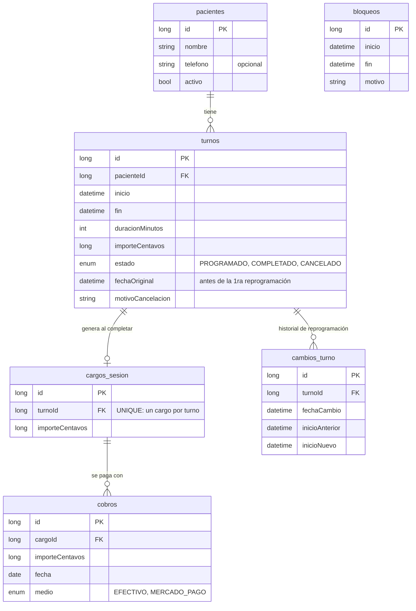

- **Saldo y pendiente no se guardan**: se calculan con SQL (`CobroDao.observarSaldos`, `observarCargos`).
- Claves foráneas con `RESTRICT` (no se puede borrar un paciente con turnos) y `CASCADE` solo en `cambios_turno`.
- `turnos.fin` es redundante con la duración, pero permite consultar superposiciones en SQL con índice.
- `bloqueos` no tiene relación con turnos; la validación es por intervalos.

---

## 7. Reglas de negocio

Todas en `domain/rules/` (Kotlin puro, con tests).

| Regla | Dónde | Detalle |
|---|---|---|
| Horario de atención | `HorarioAtencion` | Lunes a viernes 9 a 18, sábados 9 a 12, domingos cerrado. Un turno debe empezar y terminar dentro de la franja |
| Sin superposición | `ReglasAgenda.validarHorario` | Intervalos semiabiertos `[inicio, fin)`: un turno 9–10 y otro 10–11 **no** chocan. Los turnos cancelados liberan el horario. Al reprogramar se ignora el propio turno |
| Períodos bloqueados | `ReglasAgenda.validarHorario` | No se puede dar un turno que toque un bloqueo |
| Bloqueos sobre turnos | `ReglasAgenda.validarBloqueo` | No se puede bloquear encima de turnos **programados** (sí sobre completados) |
| Huecos libres | `ArmadoAgenda` | Huecos de 60 minutos dentro del horario de atención, que no choquen con turnos ni bloqueos y que no hayan empezado |
| Estados del turno | `TurnoRepositoryImpl` | Solo un turno PROGRAMADO se puede completar, reprogramar o cancelar |
| Cargo al completar | `TurnoRepositoryImpl.completar` | Completar crea un `CargoSesion` con el importe del turno, en la misma transacción. Si se reintenta, devuelve el mismo cargo (no duplica) |
| Cobros | `ReglasCobro` | Pendiente = cargo − suma de cobros. Se rechazan montos ≤ 0 o mayores al pendiente. Ejemplo RF04: $20.000 − $8.000 = $12.000; + $12.000 = $0 |
| Paciente inactivo | `ReservarTurno` | No se le pueden dar turnos nuevos; conserva historial y saldo |
| Validación doble | Casos de uso + repositorio | Validación rápida para feedback, y validación definitiva **dentro de la transacción** de escritura (evita condiciones de carrera) |

---

## 8. Seguridad y privacidad

| Mecanismo | Implementación |
|---|---|
| Base cifrada | SQLCipher (`net.zetetic:sqlcipher-android`) vía `SupportOpenHelperFactory`. Verificado: el archivo no contiene nombres en claro ni la cabecera `SQLite format 3` |
| Clave de la base | 32 bytes aleatorios, guardados **cifrados con AES-GCM** con una clave de **Android Keystore** que nunca sale del dispositivo (`ClaveBaseDatos`). Archivo en `noBackupFilesDir` |
| Contraseña | Nunca se guarda: solo **hash PBKDF2-HMAC-SHA256** (120.000 iteraciones, salt aleatorio de 16 bytes), comparación en tiempo constante (`Credenciales`) |
| Usuario | Uno por dispositivo; se normaliza (minúsculas, sin espacios) |
| Bloqueo | Login al abrir; vuelve a pedirlo tras **2 minutos en segundo plano** (`SesionSeguridad` + `ProcessLifecycleOwner`) o al tocar **cerrar sesión** |
| Huella / PIN | `BiometricPrompt` con `BIOMETRIC_WEAK or DEVICE_CREDENTIAL` como atajo de ingreso |
| Capturas y recientes | `FLAG_SECURE` en **release** (oculta la app en recientes y bloquea capturas). En **debug** está desactivado para poder revisar pantallas |
| Backups | `allowBackup=false` y reglas que excluyen todo de backup en la nube y transferencia entre dispositivos |
| Permisos | Ninguno peligroso (sin contactos, cámara ni ubicación) |
| WhatsApp | Solo se abre con un borrador; nunca se envía automáticamente |
| Navegación | Las rutas no llevan datos del paciente |
| Falla de la clave | Si la base no abre, pantalla de error con *Reintentar* o *Empezar de cero* (borra base y clave, conserva el usuario). Nunca se muestran ni registran detalles técnicos que puedan incluir datos |

> ⚠️ **Sin recuperación**: si se pierde el celular, se desinstala la app o se borran sus datos, la información **no se puede recuperar** (no hay backup ni servidor). Está declarado en la preentrega, pero conviene recordarlo al usuario (ver sugerencias).

---

## 9. Trazabilidad con requisitos (RF / RNF)

| Requisito | Estado | Dónde / cómo se verificó |
|---|---|---|
| RF01 Gestionar pacientes | ✅ | Pantalla Pacientes. Probado: alta, edición, ficha, búsqueda |
| RF02 Agenda de sesiones | ✅ | Hoy / Agenda. Superposición: `ReglasAgendaTest`, `AgendaDatabaseTest`. Probado: alta, completar, reprogramar |
| RF03 Bloqueo de agenda | ✅ | Diálogo Bloquear período. Probado: bloqueo 12–13 y rechazo sobre turno |
| RF04 Cobros y saldos | ✅ | Probado en la app con el ejemplo exacto: $20.000 → cobro $8.000 → pendiente $12.000 → cobro $12.000 → saldado. Rechazo de $13.000 |
| RF05 WhatsApp | ✅ | Borrador tras reprogramar; abre `wa.me` (probado: abre Chrome sin WhatsApp instalado) |
| RNF01 Offline | ✅ | Todo es local; no hay llamadas de red |
| RNF02 Base cifrada + Keystore | ✅ | `AgendaDatabaseTest.archivoDeBaseEstaCifrado` |
| RNF03 Privacidad | ✅ | Sin backups, sin logs de datos, sin permisos, `FLAG_SECURE` en release |
| RNF04 Acceso | ✅ modificado | Usuario y contraseña propios + huella/PIN como atajo + bloqueo a los 2 min + cerrar sesión. Ver justificación en §12 |
| RNF05 Accesibilidad | 🟡 parcial | Botones ≥ 48 dp, estados con texto, `contentDescription` en íconos, encabezados semánticos. **Falta probar TalkBack y texto al 200 %** |
| RNF06 Rendimiento | ⏳ sin medir | Falta la prueba con 500 pacientes / 5.000 turnos |
| RNF07 Confiabilidad | ✅ | Transacciones + `Resultado`; reintento de completar sin duplicar (`AgendaDatabaseTest`); errores de apertura y de lectura sin cierres inesperados |
| RNF08 Compatibilidad | 🟡 | `minSdk` **26** (Android 8.0), igual que la preentrega. Probado en API 34 y 35; **falta probar en Android 8** |
| RNF09 Mantenibilidad | ✅ | Reglas probadas sin Android; UI → ViewModel → repositorios |

---

## 10. Tests

| Test | Tipo | Qué verifica | Comando |
|---|---|---|---|
| `domain/rules/ReglasAgendaTest` (10) | JVM | Superposición, contiguos, cancelados, reprogramar, bloqueos, horario de atención | `./gradlew :app:testDebugUnitTest` |
| `domain/rules/ArmadoAgendaTest` (5) | JVM | Huecos por día de semana, sábado, domingo, orden, cancelados, huecos pasados | idem |
| `domain/rules/ReglasCobroTest` (5) | JVM | Ejemplo RF04 y validación de montos | idem |
| `core/util/FormatosTest` (3) | JVM | Parseo de montos ("20.000", "20000,50"…) | idem |
| `core/security/CredencialesTest` (2) | JVM | Crear y verificar usuario; contraseña nunca en texto plano | idem |
| `data/AgendaDatabaseTest` (3) | Instrumentado | Archivo cifrado, superposición en transacción, cobro RF04 y completar idempotente | `./gradlew :app:connectedDebugAndroidTest` |

**Resultado actual:** 25/25 JVM ✅ · 3/3 instrumentados ✅ (corridos antes de las últimas pantallas) · lint sin errores.

**Prueba manual en emulador** (Android 14, AVD liviano): registro, login correcto e incorrecto, alta y edición de paciente, turno desde hueco, completar + cobro parcial + total, error de monto, agenda de otro día, reprogramar + WhatsApp, bloqueo válido y rechazado, cerrar sesión. Sin crashes.

---

## 11. Dependencias

Definidas en `gradle/libs.versions.toml`.

| Dependencia | Versión | Para qué |
|---|---|---|
| AGP / Gradle | 9.3.3 / 9.5.0 | Build |
| Kotlin (Compose + serialization plugins) | 2.2.10 | Lenguaje |
| KSP | 2.3.10 | Generación de código de Room |
| Compose BOM / Material 3 | 2026.02.01 | UI |
| material-icons-core | 1.7.8 | Íconos básicos (se reemplazó *extended*: el APK bajó de 29 a 22 MB) |
| Navigation Compose | 2.10.1 | Navegación con rutas tipadas |
| Lifecycle (ViewModel, runtime-compose, process) | 2.11.0 | ViewModels, `collectAsStateWithLifecycle`, bloqueo por inactividad |
| Room (runtime, ktx, compiler) | 2.8.4 | Base de datos |
| SQLCipher for Android | 4.19.0 | Cifrado de la base (licencia BSD-style; revisar atribución) |
| androidx.sqlite | 2.6.2 | Requerido por SQLCipher |
| Biometric | 1.1.0 | Huella / PIN |
| DataStore Preferences | 1.2.1 | Preferencias no sensibles |
| kotlinx-serialization-json | 1.9.0 | Rutas de navegación |
| JUnit 4 / coroutines-test | 4.13.2 / 1.10.2 | Tests |

---

## 12. Cambios respecto de la preentrega

La consigna pide que toda modificación significativa pueda **explicarse y justificarse**. Estos son los cambios, con su motivo y el texto sugerido para actualizar el documento del TPO.

### 12.1 Acceso con usuario y contraseña (RNF04)

- **Antes:** "El acceso requiere autenticación del dispositivo, la app vuelve a bloquearse al permanecer en segundo plano más de 2 minutos."
- **Ahora:** usuario y contraseña propios de la app; la huella o el PIN del celular quedan como **atajo opcional**.
- **Por qué:**
  - Muchos profesionales comparten el celular con la familia o lo tienen sin bloqueo de pantalla; depender solo del bloqueo del dispositivo dejaba los datos de pacientes abiertos a cualquiera que lo desbloquee.
  - Una contraseña propia separa "acceso al celular" de "acceso a la historia administrativa de pacientes".
  - El wireframe 01 ya mostraba usuario y contraseña.
- **Cómo se protege:** la contraseña nunca se guarda; solo un hash PBKDF2 con salt. Un único usuario por dispositivo.
- **Texto sugerido:**
  > **RNF04 Acceso.** El acceso requiere usuario y contraseña propios de la aplicación (la contraseña se almacena solo como hash PBKDF2 con salt). La huella o el PIN del dispositivo pueden usarse como atajo una vez creado el usuario. La app vuelve a pedir el acceso al permanecer más de 2 minutos en segundo plano o al cerrar sesión.

### 12.2 Horario de atención (regla nueva)

- **Antes:** no estaba definido.
- **Ahora:** lunes a viernes de 9 a 18, sábados de 9 a 12, domingos sin atención. No se pueden dar turnos fuera de ese horario y la agenda muestra los huecos libres dentro de él.
- **Por qué:** para mostrar "Disponible" (wireframes 02 y 03) hace falta saber cuándo atiende el profesional, y evita agendar por error un domingo o a la noche.
- **Limitación:** está fijo en el código (`HorarioAtencion.kt`); hacerlo configurable es una mejora sugerida.
- **Texto sugerido** (agregar a RF02):
  > Los turnos solo pueden registrarse dentro del horario de atención (lunes a viernes de 9 a 18 h y sábados de 9 a 12 h).

### 12.3 Cinco pantallas con diálogos en lugar de 31 pantallas

- **Antes:** los wireframes muestran ~31 pantallas (cada formulario, confirmación y estado como pantalla aparte).
- **Ahora:** 5 pantallas (Login, Hoy, Agenda, Pacientes, Cobros). Formularios, detalle, ficha y confirmaciones son **diálogos y paneles** sobre la pantalla actual.
- **Por qué:**
  - Menos navegación y menos carga cognitiva: el profesional nunca pierde de vista la agenda (mirada de Weiser, sección 4.2 de la consigna).
  - Flujos más cortos entre sesiones: completar → cobrar → volver a la agenda sin salir de la pantalla.
  - Las 31 pantallas del wireframe siguen representadas: son los mismos contenidos y estados, presentados como diálogos.

### 12.4 Pantalla de login (wireframe 01)

- Se quitó el texto "Tu agenda y tus cobros, en este celular."; "AgendaSalud" quedó centrado y grande.
- Se agregó **Registrarse**, visible solo si todavía no hay usuario.
- **Por qué:** pedido del equipo para simplificar la primera pantalla. **Actualizar el Figma.**

### 12.5 Recuperación ante errores (nuevo, consigna 7.3)

- Si la base cifrada no se puede abrir, la app ya no se cierra: muestra un error con *Reintentar* y *Empezar de cero*.
- Si una lectura falla con la app abierta, se muestra un aviso en lugar de cerrarse.
- **Por qué:** la consigna pide comunicar qué ocurre y qué puede hacer el usuario. El caso más realista es que Android invalide la clave del Keystore (por ejemplo, al quitar el bloqueo de pantalla).

### 12.6 Otros

| Tema | Detalle |
|---|---|
| minSdk | Unificado en **26** (Android 8.0), como dice RNF08 |
| Estados offline y permisos | No aplican: la app no usa red ni permisos peligrosos. Se aclara en la defensa (consigna 7.3) |
| Retrofit | No se usa: no hay comunicación remota en la v1 (la integración con prepagas era de la fase paga, fuera de alcance) |
| Íconos | Material *core* + 4 vectores propios (el APK bajó de 29 a 22 MB) |
| `.gitignore` | `data/` ignoraba también la capa de datos del código; ahora es `/data/`. Se versiona `gradle-wrapper.jar` |

## 13. Verificaciones pendientes

Cosas **no probadas todavía** o que conviene revisar antes de la entrega:

- [ ] **Correr los tests instrumentados de nuevo** (`connectedDebugAndroidTest`) con la versión final.
- [ ] **Probar en un celular real**, idealmente con WhatsApp instalado, para verificar que *Abrir WhatsApp* abre el chat con el texto.
- [ ] **Huella / PIN**: no se pudo probar en el emulador (no tenía bloqueo configurado).
- [ ] **Bloqueo a los 2 minutos**: dejar la app en segundo plano > 2 min y verificar que pide login.
- [ ] **Release**: generar un APK release y verificar `FLAG_SECURE` (pantalla en negro en recientes) y que la app funciona con R8 (hoy `optimization.enable = false`).
- [ ] **RNF05 Accesibilidad**: TalkBack recorriendo las 5 pantallas; texto al 200 % (Ajustes → Pantalla → Tamaño de fuente) sin cortes, en especial los botones lado a lado de Agenda.
- [ ] **RNF06 Rendimiento**: cargar 500 pacientes y 5.000 turnos ficticios y medir las consultas.
- [ ] **RNF08 Compatibilidad**: probar en Android 8.0 (API 26) y en una versión reciente.
- [ ] **Modo oscuro**: revisar contraste de las tarjetas (azul / rosa / borde).
- [ ] **Zona horaria**: el emulador estaba en UTC; probar en hora de Argentina que "Hoy" y los huecos pasados se calculen bien cerca de la medianoche.
- [ ] **Teléfonos**: `numeroWhatsApp` asume números argentinos (agrega `549` a números de 10 dígitos). Probar con formatos variados (`+54 9 11…`, `011 15…`).
- [ ] **Bloqueos de varios días**: probar un bloqueo de vacaciones de una semana y su visualización en cada día.
- [ ] **Desactivar paciente con turnos futuros**: hoy se permite y los turnos quedan; decidir si hay que avisar o cancelarlos.
- [ ] **Licencia de SQLCipher**: verificar requisitos de atribución antes de publicar.

---

## 14. Sugerencias de mejora

### Funcionales

1. **Horario de atención configurable** (hoy está fijo en `HorarioAtencion`): pantalla de ajustes usando el `PreferenciasRepository` que ya existe.
2. **Duración de los huecos** según la duración predeterminada (hoy son de 60 min fijos en `ArmadoAgenda.armar`).
3. **Recuperación de contraseña**: hoy, si el profesional la olvida, solo puede borrar los datos de la app. Opciones: pregunta de seguridad, o permitir reset usando la huella/PIN del celular.
4. **Cambiar contraseña** desde la app.
5. **Exportar / respaldar datos** (carpeta `presentation/respaldo` prevista): exportación cifrada manual, para mitigar el "sin recuperación".
6. **Vista semanal o mensual** de la agenda.
7. **Turnos recurrentes** (ej. todos los martes 10:00), muy comunes en psicología.
8. **Reporte de cancelaciones** anual por paciente (hoy solo está el número en la ficha).
9. **Recordatorios** al profesional (notificación local antes del turno, sin nombre del paciente en pantalla bloqueada).
10. **WhatsApp también al dar o cancelar un turno**, no solo al reprogramar.
11. **Deshacer** acciones (ej. "Turno cancelado · Deshacer" en el snackbar).

### Técnicas

1. **Habilitar R8** en release (`optimization.enable = true`) y probar las reglas de keep de SQLCipher/Room.
2. **Tests de ViewModel** con repositorios falsos (hoy solo hay tests de reglas y de base).
3. **Tests de UI** con Compose (`createComposeRule`) para los flujos principales.
4. **Tests de capturas** (Roborazzi/Paparazzi) para revisar pantallas sin emulador — útil en compus lentas.
5. **Migraciones de Room**: el esquema v1 está exportado en `app/schemas/`; cualquier cambio de tablas necesita una migración.
6. **Bloquear la clave de la base a la autenticación** (`setUserAuthenticationRequired`) para que la base no pueda abrirse sin login.
7. **Limitar intentos de login** (demora creciente tras varios errores).
8. **Inyección de dependencias con Hilt** si el proyecto crece.
9. **CI en GitHub Actions**: compilar + tests + lint en cada PR.
10. **Strings**: algunos textos del borrador de WhatsApp están en el ViewModel; moverlos a `strings.xml`.
11. **Dividir `Daos.kt` y `Entidades.kt`** en un archivo por clase si crecen.
12. Actualizar dependencias que lint marca como desactualizadas (no urgente).

### UX

1. Mostrar el **saldo del paciente** dentro del panel de acciones del turno.
2. En *Nuevo turno*, **buscador de pacientes** cuando la lista sea larga (hoy es un menú desplegable).
3. Deshabilitar en el calendario los **domingos** y días fuera de horario.
4. Indicador visual del **día de hoy** en la Agenda y atajo "Volver a hoy".
5. Confirmación antes de **cerrar sesión** si hay un formulario a medio completar.

---

## 15. Guía rápida para el equipo

| Si querés… | Tocá… |
|---|---|
| Cambiar un texto | `app/src/main/res/values/strings.xml` |
| Cambiar el horario de atención | `domain/rules/HorarioAtencion.kt` (+ su test) |
| Agregar una regla de negocio | `domain/rules/` + test en `app/src/test/…/domain/rules/` |
| Agregar un campo a una tabla | `data/local/entity/Entidades.kt` + `Mapeos.kt` + modelo en `domain/model/` + **subir versión y migración** en `AgendaDatabase.kt` |
| Agregar una consulta | `data/local/dao/Daos.kt` → interfaz en `domain/repository/Repositorios.kt` → `*RepositoryImpl.kt` |
| Agregar una pantalla/pestaña | Ruta en `Rutas.kt`, `composable<…>` y pestaña en `AgendaSaludNavHost.kt` |
| Agregar un diálogo a una pantalla | Estado `var x by remember` en la pantalla + composable del diálogo (ver `TurnoDialogos.kt`) |
| Mostrar un aviso | Desde el ViewModel: `avisar(Aviso.Exito(R.string.…))` |
| Agregar un error de negocio | `ErrorDominio` en `Resultado.kt` + texto en `Avisos.kt` (`mensaje()`) + `strings.xml` |

**Flujo de trabajo** (sección 16 de la preentrega): `main` estable, ramas `feature/*`, PR revisado por otro integrante, commits chicos.
