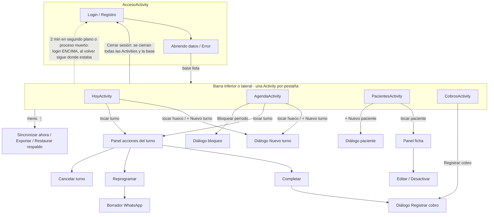
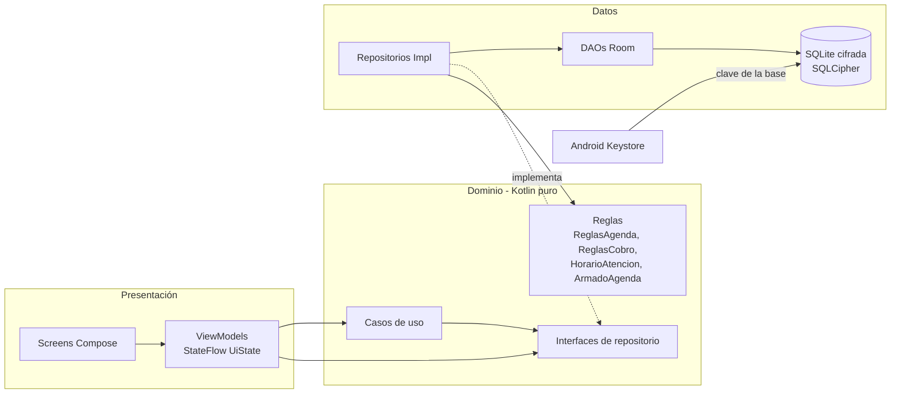
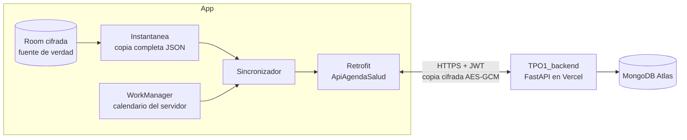
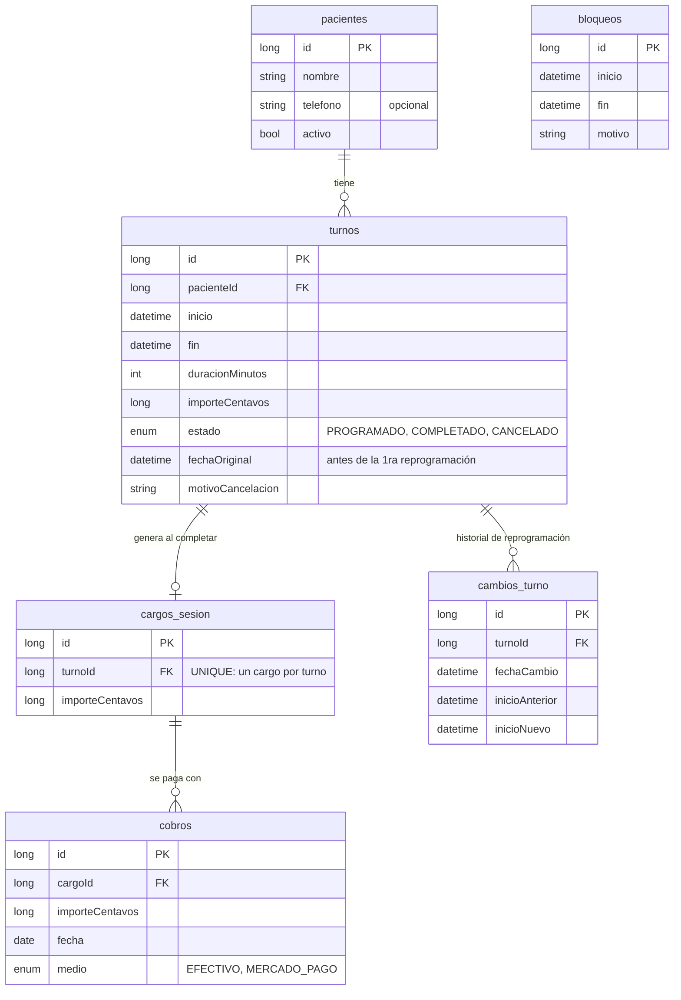

# AgendaSalud — Documentación de la implementación

> Estado del código en la rama `feature/federico` (noviembre 2026).
> Este documento explica **qué hay**, **dónde está**, **cómo funciona** y **qué falta revisar**.
> Complementa la preentrega (`docs/Desarrollo de Aplicaciones I-VI-NOCHE-TPO-Grupo nn Preentrega.md`).

---

## Índice

1. [Resumen](#1-resumen)
2. [Cómo compilar, probar y ejecutar](#2-cómo-compilar-probar-y-ejecutar)
3. [Pantallas y flujos](#3-pantallas-y-flujos)
4. [Arquitectura](#4-arquitectura)
5. [Estructura de carpetas y archivos](#5-estructura-de-carpetas-y-archivos)
6. [Modelo de datos (Room)](#6-modelo-de-datos-room)
7. [Reglas de negocio](#7-reglas-de-negocio)
8. [Seguridad y privacidad](#8-seguridad-y-privacidad)
9. [Trazabilidad con requisitos (RF / RNF)](#9-trazabilidad-con-requisitos-rf--rnf)
10. [Tests](#10-tests)
11. [Dependencias](#11-dependencias)
12. [Cambios respecto de la preentrega](#12-cambios-respecto-de-la-preentrega)
13. [Verificaciones pendientes](#13-verificaciones-pendientes)
14. [Sugerencias de mejora](#14-sugerencias-de-mejora)
15. [Guía rápida para el equipo](#15-guía-rápida-para-el-equipo)
16. [Teoría de la cursada aplicada al proyecto](#16-teoría-de-la-cursada-aplicada-al-proyecto)

---

## 1. Resumen

App Android nativa (Kotlin + Jetpack Compose) para que un profesional independiente de salud gestione **agenda, pacientes y cobros** desde el celular, **sin conexión** y con los datos **cifrados en el dispositivo** (modelo *offline-first*). La cuenta y una copia cifrada de los datos viven en el **backend del equipo** (`TPO1_backend/`, FastAPI de Francisco); la app los sincroniza en segundo plano y el servidor no puede leerlos.

**Lo que funciona hoy** (probado en emulador Android 14):

| Área | Qué se puede hacer |
|---|---|
| Acceso | Registrar el usuario la primera vez, ingresar con usuario y contraseña, ingresar con huella/PIN del celular (atajo opcional), cerrar sesión, bloqueo automático a los 2 minutos en segundo plano |
| Hoy | Ver turnos, huecos libres y bloqueos del día; saldos pendientes de los pacientes del día; dar turnos; completar, cobrar, reprogramar y cancelar |
| Agenda | Lo mismo que Hoy para cualquier día (flechas o selector de fecha) + bloquear y quitar períodos (vacaciones, cursos) |
| Pacientes | Buscar, ver saldo, alta, edición, ficha con historial y cancelaciones del año, desactivar y reactivar |
| Cobros | Lista de cargos pendientes o todos, total pendiente, registrar cobros totales o parciales (efectivo / Mercado Pago) |
| WhatsApp | Tras reprogramar, borrador editable para avisar al paciente: abrir WhatsApp o copiar el texto |
| Respaldo | Exportar un archivo cifrado con contraseña propia (a Drive, mail, pendrive) y restaurarlo en otro celular |
| Cuenta y sincronización | Cuenta con email en el backend del equipo; copia cifrada de todos los datos según el calendario del servidor (cada 6 h, con wifi) o con *Sincronizar ahora*. En un celular nuevo se ingresa con la misma cuenta y los datos se descargan. Recuperación de contraseña por email |

**Decisión de diseño principal:** son **5 pantallas, cada una en su propia Activity**: `AccesoActivity` (login), `HoyActivity`, `AgendaActivity`, `PacientesActivity` y `CobrosActivity`. Todas las acciones (nuevo turno, cobro, reprogramar, ficha, respaldo, etc.) se resuelven con **diálogos y paneles inferiores** dentro de esas pantallas, sin navegar a pantallas nuevas.

---

## 2. Cómo compilar, probar y ejecutar

### Requisitos

- Android Studio (cualquier versión reciente con AGP 9.x). Trae su propio JDK.
- Android SDK con **API 37** (Gradle la descarga sola la primera vez si falta).
- Gradle **9.5.0** (se baja solo vía `gradlew`).

### Desde Android Studio

1. Abrir la carpeta `TPO1_app` (no la raíz del repo).
2. Esperar el *Gradle sync*.
3. Elegir un dispositivo y tocar **Run ▶**.

### Desde la terminal (macOS)

```bash
cd TPO1_app
export JAVA_HOME="/Applications/Android Studio.app/Contents/jbr/Contents/Home"

./gradlew :app:assembleDebug            # genera app/build/outputs/apk/debug/app-debug.apk
./gradlew :app:assembleRelease          # versión release con R8 (sin firmar): app/build/outputs/apk/release/
./gradlew :app:testDebugUnitTest        # tests de reglas (sin Android, segundos)
./gradlew :app:lintDebug                # análisis estático
./gradlew :app:connectedDebugAndroidTest  # tests de base cifrada (requiere emulador o celular)
```

### Emulador en una compu con pocos recursos

En compus de bajo consumo (por ejemplo MacBook Air con i5 de 2 núcleos) el emulador estándar con Play Store **no llega a arrancar** (el sistema Android se cae por timeout). Lo que sí funcionó:

- AVD **"AgendaSalud Liviano"**: Android 14 (API 34) imagen *Google APIs* **sin Play Store**, 720×1600, 2 núcleos, 2 GB, sin cámaras/sensores, Quick Boot activado. Aparece en *Device Manager*.
- El primer arranque tarda ~10 minutos; después, con Quick Boot, arranca en segundos.
- **No compilar con Gradle mientras el emulador está corriendo** (compilar, cerrar Gradle con `./gradlew --stop`, recién ahí abrir el emulador).
- Alternativas sin emulador: un celular Android por USB, o *Device Streaming* (Android Studio → Device Manager → Firebase).

### Backend local

La app en debug se conecta a `http://10.0.2.2:8000/` (la compu vista desde el emulador), que es donde corre el backend de Francisco con Docker:

```bash
cd TPO1_backend
docker compose up -d        # API en el puerto 8000 + MongoDB
```

Ver `TPO1_backend/README.md`. Para release, poner la URL de Vercel en `URL_SERVIDOR` (`app/build.gradle.kts`).

### Usuario de prueba

No hay usuario precargado: la primera vez se toca **Registrarse** (con el backend corriendo; la cuenta se crea con un **email**). Para empezar de cero se borran los datos de la app (`adb shell pm clear ar.edu.fguerrero.da1.agendasalud`) — **esto borra todo, incluida la base**.

---

## 3. Pantallas y flujos

Capturas tomadas del emulador durante la prueba manual (`docs/capturas/`).

### 3.1 Login (wireframe 01)

| Con usuario creado | Sin usuario | Registro |
|---|---|---|
|  |  |  |

- Siempre se muestra primero **Ingresar** (email + contraseña de al menos 8 caracteres, como pide el backend).
- **Registrarse** crea la cuenta en el servidor (necesita internet) y después la local.
- **Ingresar en un celular que ya se usó**: la contraseña se verifica **localmente**, así se entra sin conexión. En segundo plano se obtiene el token del servidor.
- **Ingresar en un celular nuevo**: se valida contra el servidor, se recupera la clave de datos y se crea la cuenta local; la primera sincronización **descarga** todos los datos.
- **¿Olvidaste tu contraseña?**: el servidor manda un mail con un enlace `agendasalud://reset-password?token=…`; al tocarlo se abre la app en *Nueva contraseña*. Si se cambia desde el celular que tiene los datos, se conservan (la clave de datos se vuelve a envolver con la nueva contraseña); si se cambia desde otro, la copia del servidor deja de poder leerse y la app lo advierte antes.
- El botón **Registrarse** aparece **solo si todavía no hay usuario** en el celular (un único profesional por dispositivo).
- Si hay huella o PIN configurado en el celular, aparece **"Ingresar con huella o PIN"** como atajo. Si la huella falla se muestra el motivo; si el usuario cancela, no.
- Después del login se **abre la base cifrada** ("Abriendo tus datos…"). Si no se puede abrir (por ejemplo, Android invalidó la clave del Keystore al quitar el bloqueo de pantalla), en vez de cerrarse la app muestra **"No se pudieron abrir tus datos"** con *Reintentar*, *Empezar de cero* (borra todo, con confirmación) y *Cerrar sesión*.
- Todo esto vive en **`AccesoActivity`**. Cuando la base está lista abre `HoyActivity` y se cierra, así *Atrás* desde la app no vuelve al login.
- Archivos: `presentation/acceso/AccesoActivity.kt`, `AccesoViewModel.kt`, `LoginScreen.kt`, `LoginViewModel.kt`, `AperturaBaseScreen.kt`, `core/security/Credenciales.kt`.

### 3.2 Hoy (wireframe 02)

| Turnos del día | Acciones de un turno | Cerrar sesión |
|---|---|---|
|  |  |  |

- Lista mezclada y ordenada por hora: **turnos** (azul), **huecos libres** (blanco con borde), **bloqueos** (rosa). El estado también se indica con texto, no solo con color (RNF05).
- No se ofrecen huecos que ya empezaron.
- Debajo: "Pendiente de *paciente*: $X" para los pacientes con turno ese día y saldo.
- **Tocar un hueco** → diálogo *Nuevo turno* con la hora precargada.
- **Tocar un turno** → panel con: Completar sesión, Reprogramar, Cancelar turno (si está programado) o Registrar cobro (si está completado).
- **Completar sesión** abre directamente *Registrar cobro* (flujo "Cobrar" de la preentrega).
- Botón **+ Nuevo turno** siempre visible abajo.
- Menú **⋮** arriba a la derecha (en las 4 pestañas): *Exportar respaldo*, *Restaurar respaldo* y *Cerrar sesión*.
- Si la app quedó abierta de un día para otro, al volver a la pantalla salta sola al día actual y deja de ofrecer los huecos que ya pasaron.
- Archivos: `presentation/turnos/AgendaDia.kt` (`HoyScreen`), `AgendaDiaViewModel.kt`, `TurnoDialogos.kt`.

### 3.3 Registrar cobro (wireframes 13–16)

| Cobro parcial | Error: monto mayor al pendiente |
|---|---|
|  |  |

- Muestra paciente, fecha de sesión y pendiente. El monto viene precargado con el total pendiente.
- Fecha editable (hoy por defecto) y medio: **Efectivo** o **Mercado Pago**.
- Los errores se muestran **dentro del diálogo** y no se guarda nada (RNF07).
- Archivo: `presentation/pagos/RegistrarCobroDialog.kt` (lo usan Hoy, Agenda y Cobros).

### 3.4 Agenda del día (wireframe 03) y bloqueos (22–23)

| Agenda con bloqueo | Borrador de WhatsApp tras reprogramar |
|---|---|
|  |  |

- Igual que Hoy, más: flechas **día anterior / siguiente**, botón de fecha (calendario) y **Hoy** (aparece si se está mirando otro día).
- **Bloquear período**: desde (fecha + hora), hasta (fecha + hora) y motivo. No se puede bloquear encima de turnos programados ("Hay turnos programados en ese período…").
- Tocar un bloqueo → confirmar para **quitarlo**.
- **Reprogramar** → nueva fecha y hora → se guarda → aparece el **borrador de WhatsApp** (editable) con *Copiar texto*, *Abrir WhatsApp* y *Ahora no*. Nunca se envía solo.
- Domingos: "No hay atención este día". En los calendarios de *Nuevo turno* y *Reprogramar* los domingos están deshabilitados.
- Archivos: `presentation/turnos/AgendaDia.kt` (`AgendaScreen`), `presentation/disponibilidad/BloquearPeriodoDialog.kt`, `TurnoDialogos.kt` (`WhatsAppDialog`).

### 3.5 Pacientes (wireframes 04–07, 30–31)


- Buscador por nombre (consulta a la base 300 ms después de dejar de escribir), filtro **Ver inactivos**, saldo pendiente por paciente.
- **+ Nuevo paciente**: nombre (obligatorio) y teléfono (opcional, se usa para WhatsApp).
- Tocar un paciente → **ficha** (panel inferior): teléfono, saldo, cancelaciones del año, últimos 20 turnos, *Editar*, *Desactivar* (con confirmación) o *Reactivar*.
- Un paciente desactivado conserva su historial y no aparece para nuevos turnos.
- Archivos: `presentation/pacientes/PacientesScreen.kt`, `PacientesViewModel.kt`.

### 3.6 Cobros pendientes (wireframe 12)


- Total pendiente arriba; filtro **Pendientes / Todos**.
- Cada cargo: paciente, sesión, cargo, cobrado y pendiente (o "Saldado") + botón **Registrar cobro**.
- Nota: "Saldo calculado a partir de cargos y cobros. No se edita manualmente."
- Archivos: `presentation/pagos/CobrosScreen.kt`, `CobrosViewModel.kt`.

### 3.7 Respaldo (menú ⋮)

- **Exportar respaldo**: se elige una contraseña del respaldo (dos veces) → el selector de Android pide dónde guardar (`agendasalud-AAAA-MM-DD.respaldo`; puede ser Google Drive) → "Respaldo guardado: N pacientes, N turnos y N cobros".
- **Restaurar respaldo**: advertencia (*reemplaza todos los datos*) → elegir el archivo → contraseña → "Datos restaurados…". Si la contraseña es incorrecta, el diálogo queda abierto con el error.
- **Celular nuevo o robado**: lo habitual es **Ingresar** con la misma cuenta (los datos bajan del servidor, §3.8). El respaldo en archivo es una copia propia, independiente del servidor: en el celular nuevo se ingresa y se usa **Restaurar respaldo**.
- El archivo está cifrado con **AES-256-GCM** y una clave derivada de la contraseña del respaldo (PBKDF2, 120.000 iteraciones). Google Drive solo ve bytes ilegibles. **Si se olvida esa contraseña, el respaldo no se puede abrir.**
- Archivos: `presentation/respaldo/RespaldoDialogos.kt`, `RespaldoViewModel.kt`, `data/repository/RespaldoRepositoryImpl.kt`, `data/respaldo/RespaldoJson.kt`, `data/local/dao/RespaldoDao.kt`, `core/security/CifradoRespaldo.kt`.

### 3.8 Sincronización con el backend (menú ⋮)

- Arriba del menú se ve el estado: *Sincronizado hoy a las 21:04*, *Sin conexión…*, *Sincronizando…*
- **Cuándo**: según el **calendario que define el servidor** (`sync_config.json`, `GET /sync/schedule`): hoy cada 6 horas, solo con wifi, con batería no baja y empezando en la franja de 21 a 23. También con **Sincronizar ahora** y en el primer ingreso de un celular.
- **Qué se sube**: una **copia completa** cifrada (el mismo formato que el respaldo en archivo). El servidor guarda la última y un historial.
- **Conflictos** (`LAST_WRITE_WINS_BY_TIMESTAMP`): si otro celular subió una versión nueva y en este no hubo cambios, se baja y reemplaza. Si hubo cambios en los dos, gana la copia más reciente.
- La app **nunca espera a la red**: todo se guarda primero en Room.
- Detalle técnico en §4.1.

### 3.9 Mapa de navegación



**Una Activity por pantalla** (como pidió el profesor). Lo común está en la clase base `PantallaActivity` (`presentation/navegacion/`):

- **Barra de navegación** (`MarcoPantalla`): cada botón abre la Activity de esa pestaña con `startActivity` y `FLAG_ACTIVITY_REORDER_TO_FRONT`. Si ya estaba abierta, la trae adelante **tal como quedó** (día, filtros, scroll), en vez de crear otra. Sin animación, para que se sienta como cambiar de pestaña.
- **Cada Activity tiene su propio ViewModel** (`hiltViewModel()` usa el `ViewModelStore` de esa Activity), que se limpia con `onCleared()` cuando se cierra con `finish()`.
- **Control de sesión**: con `repeatOnLifecycle(STARTED)`, cada vez que una pantalla vuelve a verse (`onStart`) se verifica la sesión; si se bloqueó, pide el login **encima** (`AccesoActivity.pedirLogin`).
- **Menú ⋮ y cierre de sesión** comunes a las 4.
- **Atrás** desde cualquier pestaña sale de la app (`finishAffinity`): las pestañas no son un historial.
- **La base se cierra** cuando se destruye la **última** pantalla de la app con `isFinishing` (un contador; nunca se guarda una referencia a una Activity).

| Situación | Qué pasa |
|---|---|
| Abrir la app | `AccesoActivity` (LAUNCHER) → login → abre la base → `HoyActivity` (con `CLEAR_TASK`) → `finish()` del acceso |
| Tocar *Pacientes* en la barra | `startActivity(PacientesActivity, REORDER_TO_FRONT)`: Hoy pasa a `onStop` (queda viva, tapada), Pacientes a `onStart`/`onResume` |
| Volver a *Hoy* | Hoy vuelve adelante con su estado; no se crea otra |
| Atrás desde cualquier pestaña | `finishAffinity()`: se cierran todas; la última en destruirse cierra la base |
| Cerrar sesión | `FLAG_ACTIVITY_CLEAR_TASK`: se cierran todas, queda solo `AccesoActivity`; la base se cierra |
| 2 min en segundo plano | Al volver, la pantalla visible (en `onStart`) ve la sesión bloqueada y abre `AccesoActivity` encima; tras el login, `finish()` y sigue donde estaba |
| Android mató el proceso | Se recrea la pantalla que estaba visible con su estado guardado, sin base abierta: muestra solo el fondo y pide el login encima; al volver recupera el día, la búsqueda y los filtros (`SavedStateHandle`) |
| Atrás en el login pedido encima | `finishAffinity()`: sale de la app sin mostrar los datos |
| Girar la pantalla | La Activity se recrea; el ViewModel sobrevive y los diálogos conservan lo escrito (`rememberSaveable`) |

---

## 4. Arquitectura

MVVM + repositorios, en tres capas, como en la sección 13 de la preentrega.



- **La UI nunca toca Room.** Los ViewModels usan interfaces de `domain/repository`.
- **El dominio no depende de Android ni de Compose**: las reglas se prueban con JUnit puro.
- **Lecturas**: Room → `Flow` → ViewModel (`combine`, `stateIn`) → `UiState` → Compose. Los cambios en la base se reflejan solos en todas las pantallas.
- **Escrituras**: ViewModel → caso de uso / repositorio → **transacción** (`AgendaDatabase.transaccion`) → `Resultado.Exito` o `Resultado.Fallo(ErrorDominio)`. El aviso de éxito (snackbar) solo se muestra **después** de una escritura confirmada.
- **Estado de pantalla sellado**: cada pantalla expone `StateFlow<EstadoUi<Datos>>` con `Cargando`, `Error` o `Contenido(datos)` (`presentation/comun/EstadoUi.kt`). El `when` de la pantalla tiene que contemplar los tres casos y el compilador avisa si falta uno. Un error de lectura muestra "No se pudieron leer los datos" con **Reintentar**, nunca una lista vacía.
- **Estado vs. eventos**: el estado va en `StateFlow`; los avisos de una sola vez (snackbar) y los pedidos de abrir el selector de archivos van por un `Channel`, que se consume una sola vez y no se repite al rotar.
- **Inyección de dependencias con Hilt** (`di/ModuloApp.kt`): `@HiltAndroidApp` en la Application, `@AndroidEntryPoint` en las Activities, `@HiltViewModel` + `@Inject constructor` en los ViewModels y `hiltViewModel()` en las pantallas, que ata cada ViewModel a la entrada de navegación de su pestaña. La capa `domain` no tiene anotaciones de Hilt: los casos de uso se crean en el módulo.
- **La base se abre explícitamente después del login** (`BaseDatosCifrada.abrir`, un `@Singleton`), con estados `Cerrada → Abriendo → Lista | Error`, y se cierra al cerrar sesión. La base **no** es singleton en Hilt: cada repositorio la pide al crearse, así después de un nuevo login los ViewModels nuevos reciben la base recién abierta.
- **Errores de lectura**: si una consulta falla con la app abierta, la pantalla pasa a `EstadoUi.Error` en vez de cerrarse.

### 4.1 Integración con el backend del equipo



**Endpoints que usa la app** (contrato en `TPO1_backend/app/models/schemas.py`, copiado en `data/remoto/ApiAgendaSalud.kt`):

| Endpoint | Cuándo |
|---|---|
| `POST /api/v1/auth/register` | Registrarse |
| `POST /api/v1/auth/login` | Ingresar en un celular nuevo; obtener token después de un login local; token vencido |
| `POST /api/v1/auth/recover-password` / `reset-password` | ¿Olvidaste tu contraseña? |
| `GET /api/v1/sync/schedule` | Al abrir la app: programa WorkManager con la política del servidor |
| `POST /api/v1/sync/push` / `GET /api/v1/sync/pull` | Cada sincronización |

**Claves** (`core/security/ClavesCuenta.kt`, compatible con `CryptoService` del backend: PBKDF2-SHA256 de 120.000 iteraciones y AES-256-GCM):

```
contraseña ─PBKDF2(dek_salt aleatorio)──▶ KEK ──envuelve──▶ DEK (clave de datos aleatoria)
contraseña ─PBKDF2(salt fijo + email)───▶ credencial ──▶ se manda como "password"
DEK ──cifra──▶ copia completa de los datos (ciphertext + iv + auth_tag)
servidor guarda: bcrypt(credencial) + sobre de la DEK + dek_salt + copias cifradas
```

Dos decisiones del lado de la app, sin cambiar el backend:

1. **No se manda la contraseña**, sino una credencial derivada. Si el servidor tuviera la contraseña, con el `dek_salt` (que también guarda) podría derivar la KEK, abrir la DEK y leer los datos: dejaría de ser *zero-knowledge*. El login funciona igual.
2. **`encrypted_dek` lleva el ciphertext y el tag de GCM juntos.** El backend no tiene un campo para el tag del sobre (solo `dek_iv`); sin el tag, otro celular no podría abrir la DEK. Así cabe en el contrato actual.

**Sincronización** (`data/sync/Sincronizador.kt`): lee la copia completa (`Instantanea`), calcula su **huella** (SHA-256) y la compara con la de la última sincronización para saber si hay cambios locales. Hace `pull`; si el servidor tiene una versión que este celular no conoce y gana por la política de conflictos, restaura esa copia (en una transacción, todo o nada). Si no, y hay cambios, hace `push` con `version + 1`. El último cambio local se registra con el `InvalidationTracker` de Room.

**Token**: el JWT dura 1 día y el backend no tiene renovación ni logout; mientras la sesión está abierta la app guarda **en memoria** la credencial derivada y, ante un 401, pide otro. Al cerrar sesión se borra el token del celular.

---

## 5. Estructura de carpetas y archivos

Raíz del módulo: `TPO1_app/app/src/main/java/ar/edu/fguerrero/da1/agendasalud/`

```
agendasalud/
├── AgendaSaludApp.kt            Application @HiltAndroidApp; registra el bloqueo por inactividad
│
├── di/
│   └── ModuloApp.kt             Módulos de Hilt: seguridad, base, red (Retrofit), repositorios y casos de uso
│
├── core/
│   ├── security/
│   │   ├── Autenticador.kt      BiometricPrompt (huella/PIN del dispositivo)
│   │   ├── CifradoRespaldo.kt   AES-256-GCM con clave derivada de la contraseña del respaldo (JVM puro)
│   │   ├── CifradorKeystore.kt  Cifra secretos chicos (token, clave de datos) con Android Keystore
│   │   ├── ClavesCuenta.kt      KEK, sobre de la DEK, credencial y cifrado de la copia (compatible con el backend)
│   │   ├── PantallaSegura.kt    FLAG_SECURE en release (lo llaman todas las Activities)
│   │   ├── ClaveBaseDatos.kt    Genera la clave de SQLCipher y la guarda cifrada con Android Keystore
│   │   ├── Credenciales.kt      Usuario + hash PBKDF2 de la contraseña (archivo en noBackupFilesDir)
│   │   └── SesionSeguridad.kt   Estado desbloqueada/bloqueada, bloqueo a los 2 min, cerrar sesión
│   └── util/
│       └── Formatos.kt          Pesos ($ 20.000), parseo de montos, fechas y horas en es-AR
│
├── domain/                      ── Kotlin puro: sin Android, sin Room, sin Compose ──
│   ├── model/
│   │   ├── Paciente.kt
│   │   ├── Turno.kt             Turno + EstadoTurno (PROGRAMADO/COMPLETADO/CANCELADO) + TurnoConPaciente
│   │   ├── Intervalo.kt         [inicio, fin) y superposición
│   │   ├── BloqueoAgenda.kt
│   │   ├── Cobro.kt             CargoSesion, Cobro, MedioCobro, CargoPendiente
│   │   ├── CambioTurno.kt       Historial de reprogramaciones
│   │   ├── ItemAgenda.kt        Fila de agenda: Ocupado / Libre / Bloqueado
│   │   ├── Respaldo.kt          ResumenRespaldo (cuánto se guardó / restauró)
│   │   ├── Sincronizacion.kt    EstadoSincronizacion (sealed)
│   │   └── Resultado.kt         Resultado<T> y ErrorDominio (errores de negocio)
│   ├── rules/
│   │   ├── HorarioAtencion.kt   L-V 9 a 18, sáb 9 a 12, dom cerrado
│   │   ├── ReglasAgenda.kt      Validación de horario, superposición y bloqueos
│   │   ├── ReglasCobro.kt       Pendiente y validación de montos
│   │   └── ArmadoAgenda.kt      Arma la lista del día (turnos + bloqueos + huecos libres)
│   ├── repository/
│   │   └── Repositorios.kt      Interfaces: Paciente, Turno, Bloqueo, Cobro, Preferencias, Respaldo, Cuenta, Sincronizacion
│   └── usecase/
│       ├── ReservarTurno.kt     Valida paciente activo, duración e importe
│       ├── CompletarSesion.kt   Completa y genera el cargo
│       └── RegistrarCobro.kt    Valida monto y registra el pago
│
├── data/
│   ├── local/
│   │   ├── AgendaDatabase.kt    @Database Room v1 + apertura con SQLCipher
│   │   ├── BaseDatosCifrada.kt  @Singleton: abre, cierra y "empieza de cero" la base (EstadoBase)
│   │   ├── Converters.kt        LocalDateTime/LocalDate ↔ Long
│   │   ├── Mapeos.kt            Entidad ↔ modelo de dominio
│   │   ├── dao/Daos.kt          PacienteDao, TurnoDao, BloqueoDao, CobroDao (consultas SQL)
│   │   ├── dao/RespaldoDao.kt   Leer todo / borrar todo / insertar todo (para el respaldo)
│   │   └── entity/Entidades.kt  Tablas y filas de consulta (TurnoConNombre, CargoConCobrado, …)
│   ├── remoto/
│   │   ├── ApiAgendaSalud.kt    Interfaz Retrofit + DTOs (copia de schemas.py del backend)
│   │   ├── AlmacenCuenta.kt     Token, clave de datos y estado de sincronización, cifrados con Keystore
│   │   ├── ClienteHttp.kt       Interceptor que agrega el JWT
│   │   └── CuentaRepositoryImpl.kt  Registro, login, recuperación de contraseña
│   ├── sync/
│   │   ├── Sincronizador.kt     Push / pull de la copia completa y conflictos
│   │   └── TrabajoSincronizacion.kt  Worker, política del servidor (sync_config.json) y repositorio
│   ├── respaldo/
│   │   ├── Instantanea.kt       Copia completa: leer, restaurar y huella (la usan respaldo y sincronización)
│   │   └── RespaldoJson.kt      Formato JSON de la copia (independiente de las tablas) y sus mapeos
│   └── repository/
│       ├── Transaccion.kt       Helper: transacción + mapeo de errores a Resultado (RNF07)
│       ├── PacienteRepositoryImpl.kt
│       ├── TurnoRepositoryImpl.kt     reservar / reprogramar / cancelar / completar
│       ├── BloqueoRepositoryImpl.kt
│       ├── CobroRepositoryImpl.kt     registrar cobro, pendientes, saldos
│       ├── PreferenciasRepositoryImpl.kt  DataStore: duración e importe sugeridos
│       └── RespaldoRepositoryImpl.kt      Exportar / restaurar con Storage Access Framework
│
├── presentation/
│   ├── acceso/
│   │   ├── AccesoActivity.kt    Activity LAUNCHER: login → abrir base → HoyActivity
│   │   ├── AccesoViewModel.kt   Abre la base al desbloquear; reintentar / empezar de cero
│   │   ├── LoginScreen.kt, LoginViewModel.kt
│   │   └── AperturaBaseScreen.kt  "Abriendo tus datos…" y "No se pudieron abrir tus datos"
│   ├── comun/
│   │   ├── Avisos.kt            Snackbar de avisos, ViewModelConAvisos (estadoUi, reintentar), textos de ErrorDominio
│   │   ├── EstadoUi.kt          sealed interface Cargando / Error / Contenido
│   │   └── Componentes.kt       Encabezado + menú ⋮, BotonAncho, TarjetaTexto, CampoFecha, CampoHora, SelectorPaciente, IndicadorCarga, ErrorCarga
│   ├── navegacion/
│   │   ├── PantallaActivity.kt  Base de las 4 Activities: sesión, barra, menú ⋮, cierre de sesión
│   │   ├── MarcoPantalla.kt     Barra inferior o lateral (responsive) + snackbar + menú + respaldo
│   │   └── Pestania.kt          Las 4 pestañas y su Activity
│   ├── sincronizacion/
│   │   └── SincronizacionViewModel.kt  Programa la sincronización y arma el texto de estado del menú
│   ├── respaldo/
│   │   ├── RespaldoViewModel.kt   Pasos del respaldo (sealed PasoRespaldo)
│   │   └── RespaldoDialogos.kt    Diálogos + selectores de archivo (SAF)
│   ├── turnos/
│   │   ├── AgendaDia.kt         HoyScreen y AgendaScreen (comparten contenido)
│   │   ├── AgendaDiaViewModel.kt
│   │   └── TurnoDialogos.kt     Nuevo turno, acciones, reprogramar, cancelar, WhatsApp
│   ├── disponibilidad/
│   │   └── BloquearPeriodoDialog.kt
│   ├── pacientes/
│   │   ├── PacientesScreen.kt   Lista, ficha (panel) y diálogo de alta/edición
│   │   └── PacientesViewModel.kt
│   └── pagos/
│       ├── CobrosScreen.kt
│       ├── CobrosViewModel.kt
│       └── RegistrarCobroDialog.kt
│
└── ui/theme/                    Tema Material 3 con paleta propia (Color.kt, Theme.kt)
```

Otros archivos relevantes:

| Ruta (desde `TPO1_app/`) | Contenido |
|---|---|
| `app/build.gradle.kts` | Plugins (Compose, KSP, serialization, Hilt), dependencias, `room.schemaLocation`, R8 en release |
| `app/proguard-rules.pro` | Reglas de R8 propias (SQLCipher usa JNI) |
| `app/src/main/res/xml/network_security_config.xml` | Release: solo HTTPS. `src/debug/…` permite HTTP a `10.0.2.2` (backend local) |
| `../TPO1_backend/` | **Backend del equipo** (FastAPI + MongoDB, Vercel): ver su `README.md` y `PROPUESTA_ARQUITECTURA.md` |
| `gradle/libs.versions.toml` | Catálogo de versiones de todas las dependencias |
| `app/schemas/…/1.json` | Esquema exportado de Room v1 (base para migraciones futuras) |
| `app/src/main/AndroidManifest.xml` | `AgendaSaludApp`, `allowBackup=false`, `AccesoActivity` (LAUNCHER, `singleTop`) y las 4 Activities de pantalla (no exportadas) |
| `app/src/main/res/values/strings.xml` | **Todos los textos de la app** (en español), agrupados por pantalla |
| `app/src/main/res/xml/backup_rules.xml`, `data_extraction_rules.xml` | Excluyen todo de backups y transferencias (RNF03) |
| `app/src/main/res/drawable/ic_hoy.xml`, `ic_agenda.xml`, `ic_pacientes.xml`, `ic_cobros.xml` | Íconos de la barra inferior (vectores Material) |
| `app/src/test/…` | Tests JVM (reglas, formatos, credenciales) |
| `app/src/androidTest/…/data/AgendaDatabaseTest.kt` | Tests de base cifrada en dispositivo |
| `docs/capturas/` | Capturas de la prueba manual |

---

## 6. Modelo de datos (Room)

Base `agendasalud.db`, versión **1**, cifrada con SQLCipher. Montos siempre en **centavos** (`Long`) para evitar errores de redondeo. Fechas guardadas como "hora de pared" del dispositivo (segundos, offset fijo) para que se puedan ordenar y comparar en SQL.



- **Saldo y pendiente no se guardan**: se calculan con SQL (`CobroDao.observarSaldos`, `observarCargos`).
- Claves foráneas con `RESTRICT` (no se puede borrar un paciente con turnos) y `CASCADE` solo en `cambios_turno`.
- `turnos.fin` es redundante con la duración, pero permite consultar superposiciones en SQL con índice.
- `bloqueos` no tiene relación con turnos; la validación es por intervalos.

---

## 7. Reglas de negocio

Todas en `domain/rules/` (Kotlin puro, con tests).

| Regla | Dónde | Detalle |
|---|---|---|
| Horario de atención | `HorarioAtencion` | Lunes a viernes 9 a 18, sábados 9 a 12, domingos cerrado. Un turno debe empezar y terminar dentro de la franja |
| Sin superposición | `ReglasAgenda.validarHorario` | Intervalos semiabiertos `[inicio, fin)`: un turno 9–10 y otro 10–11 **no** chocan. Los turnos cancelados liberan el horario. Al reprogramar se ignora el propio turno |
| Períodos bloqueados | `ReglasAgenda.validarHorario` | No se puede dar un turno que toque un bloqueo |
| Bloqueos sobre turnos | `ReglasAgenda.validarBloqueo` | No se puede bloquear encima de turnos **programados** (sí sobre completados) |
| Huecos libres | `ArmadoAgenda` | Huecos de 60 minutos dentro del horario de atención, que no choquen con turnos ni bloqueos y que no hayan empezado |
| Estados del turno | `TurnoRepositoryImpl` | Solo un turno PROGRAMADO se puede completar, reprogramar o cancelar |
| Cargo al completar | `TurnoRepositoryImpl.completar` | Completar crea un `CargoSesion` con el importe del turno, en la misma transacción. Si se reintenta, devuelve el mismo cargo (no duplica) |
| Cobros | `ReglasCobro` | Pendiente = cargo − suma de cobros. Se rechazan montos ≤ 0 o mayores al pendiente. Ejemplo RF04: $20.000 − $8.000 = $12.000; + $12.000 = $0 |
| Paciente inactivo | `ReservarTurno` | No se le pueden dar turnos nuevos; conserva historial y saldo |
| Validación doble | Casos de uso + repositorio | Validación rápida para feedback, y validación definitiva **dentro de la transacción** de escritura (evita condiciones de carrera) |

---

## 8. Seguridad y privacidad

| Mecanismo | Implementación |
|---|---|
| Base cifrada | SQLCipher (`net.zetetic:sqlcipher-android`) vía `SupportOpenHelperFactory`. Verificado: el archivo no contiene nombres en claro ni la cabecera `SQLite format 3` |
| Clave de la base | 32 bytes aleatorios, guardados **cifrados con AES-GCM** con una clave de **Android Keystore** que nunca sale del dispositivo (`ClaveBaseDatos`). Archivo en `noBackupFilesDir` |
| Contraseña | Nunca se guarda: solo **hash PBKDF2-HMAC-SHA256** (120.000 iteraciones, salt aleatorio de 16 bytes), comparación en tiempo constante (`Credenciales`) |
| Usuario | Uno por dispositivo; se normaliza (minúsculas, sin espacios) |
| Bloqueo | Login al abrir; vuelve a pedirlo tras **2 minutos en segundo plano** (`SesionSeguridad` + `ProcessLifecycleOwner`) o al tocar **cerrar sesión** |
| Cierre de sesión | Se destruyen todas las Activities (y sus ViewModels) y se **cierra la base**: la clave deja de estar en memoria. Además se cancela la sincronización y se borra el token del backend. Los datos locales **no se borran**: los cambios posteriores a la última sincronización se perderían |
| Cuenta en el servidor | La contraseña **no se envía**: se manda una credencial derivada (PBKDF2) que el backend guarda con bcrypt |
| Datos en el servidor | Copia **cifrada en el celular** con AES-256-GCM; la DEK viaja envuelta con una KEK que solo se obtiene con la contraseña. El servidor no puede leer pacientes |
| Token | JWT del backend, guardado cifrado con Keystore; se borra al cerrar sesión |
| Red | Solo HTTPS en release (`network_security_config`); permiso `INTERNET` y ninguno peligroso; sin logging de pedidos |
| Enlace de recuperación | `agendasalud://reset-password`: un token de un solo uso que vence en 30 minutos |
| Respaldo | Archivo cifrado con AES-256-GCM; la clave sale de una contraseña aparte (PBKDF2) para poder abrirlo en otro celular. El encabezado está autenticado: un archivo modificado se rechaza. Se elige con SAF: la app no pide permisos de almacenamiento. La contraseña se borra de memoria al terminar y nunca va al `SavedStateHandle` |
| Huella / PIN | `BiometricPrompt` con `BIOMETRIC_WEAK or DEVICE_CREDENTIAL` como atajo de ingreso |
| Capturas y recientes | `FLAG_SECURE` en **release** (oculta la app en recientes y bloquea capturas). En **debug** está desactivado para poder revisar pantallas |
| Backups | `allowBackup=false` y reglas que excluyen todo de backup en la nube y transferencia entre dispositivos |
| Permisos | Solo `INTERNET` (sincronización). Ninguno peligroso (sin contactos, cámara ni ubicación) |
| WhatsApp | Solo se abre con un borrador; nunca se envía automáticamente |
| Navegación | Las rutas no llevan datos del paciente |
| Falla de la clave | Si la base no abre, pantalla de error con *Reintentar* o *Empezar de cero* (borra base y clave, conserva el usuario). Nunca se muestran ni registran detalles técnicos que puedan incluir datos |

> ⚠️ **Recuperación**: si se pierde el celular, se ingresa con la misma cuenta en otro y se descarga la última copia del servidor (lo cargado después de la última sincronización se pierde). Si además se **olvida la contraseña**, la copia del servidor no se puede descifrar, por diseño *zero-knowledge*. El backup automático de Google sigue desactivado a propósito: copiaría una base que en otro celular no se puede abrir (la clave está en el Keystore del celular original).

---

## 9. Trazabilidad con requisitos (RF / RNF)

| Requisito | Estado | Dónde / cómo se verificó |
|---|---|---|
| RF01 Gestionar pacientes | ✅ | Pantalla Pacientes. Probado: alta, edición, ficha, búsqueda |
| RF02 Agenda de sesiones | ✅ | Hoy / Agenda. Superposición: `ReglasAgendaTest`, `AgendaDatabaseTest`. Probado: alta, completar, reprogramar |
| RF03 Bloqueo de agenda | ✅ | Diálogo Bloquear período. Probado: bloqueo 12–13 y rechazo sobre turno |
| RF04 Cobros y saldos | ✅ | Probado en la app con el ejemplo exacto: $20.000 → cobro $8.000 → pendiente $12.000 → cobro $12.000 → saldado. Rechazo de $13.000 |
| RF05 WhatsApp | ✅ | Borrador tras reprogramar; abre `wa.me` (probado: abre Chrome sin WhatsApp instalado) |
| RNF01 Offline | ✅ | Todo se lee y escribe en Room; la red solo se usa en segundo plano para sincronizar |
| RF07 Cuenta y sincronización | 🟡 | Integrado con el backend del equipo. Cifrado compatible verificado contra `CryptoService` de Python. **Falta la prueba punta a punta** con el backend corriendo |
| RNF02 Base cifrada + Keystore | ✅ | `AgendaDatabaseTest.archivoDeBaseEstaCifrado` |
| RNF03 Privacidad | ✅ | Sin backups, sin logs de datos, sin permisos, `FLAG_SECURE` en release |
| RNF04 Acceso | ✅ modificado | Usuario y contraseña propios + huella/PIN como atajo + bloqueo a los 2 min + cerrar sesión. Ver justificación en §12 |
| RNF05 Accesibilidad | 🟡 parcial | Botones ≥ 48 dp, estados con texto, `contentDescription` en íconos, encabezados semánticos. **Falta probar TalkBack y texto al 200 %** |
| RNF06 Rendimiento | ⏳ sin medir | Falta la prueba con 500 pacientes / 5.000 turnos |
| RNF07 Confiabilidad | ✅ | Transacciones + `Resultado`; reintento de completar sin duplicar (`AgendaDatabaseTest`); errores de apertura y de lectura sin cierres inesperados; restaurar un respaldo es todo o nada |
| RNF08 Compatibilidad | 🟡 | `minSdk` **26** (Android 8.0), igual que la preentrega. Probado en API 34 y 35; **falta probar en Android 8** |
| RNF09 Mantenibilidad | ✅ | Reglas probadas sin Android; UI → ViewModel → repositorios |

---

## 10. Tests

| Test | Tipo | Qué verifica | Comando |
|---|---|---|---|
| `domain/rules/ReglasAgendaTest` (10) | JVM | Superposición, contiguos, cancelados, reprogramar, bloqueos, horario de atención | `./gradlew :app:testDebugUnitTest` |
| `domain/rules/ArmadoAgendaTest` (5) | JVM | Huecos por día de semana, sábado, domingo, orden, cancelados, huecos pasados | idem |
| `domain/rules/ReglasCobroTest` (5) | JVM | Ejemplo RF04 y validación de montos | idem |
| `core/util/FormatosTest` (3) | JVM | Parseo de montos ("20.000", "20000,50"…) | idem |
| `core/security/CredencialesTest` (2) | JVM | Crear y verificar usuario; contraseña nunca en texto plano | idem |
| `core/security/ClavesCuentaTest` (5) | JVM | Recuperar la DEK con la misma contraseña, rechazo con otra, credencial ≠ contraseña, tag separado como espera el backend, datos modificados se rechazan | idem |
| `core/security/CompatibilidadBackendTest` (2) | JVM | La app abre un sobre y una copia generados por `CryptoService` (Python) del backend | idem |
| `core/security/CifradoRespaldoTest` (5) | JVM | Ida y vuelta con la misma contraseña, archivo sin datos en claro, rechazo con otra contraseña, archivo modificado o ajeno | idem |
| `data/AgendaDatabaseTest` (3) | Instrumentado | Archivo cifrado, superposición en transacción, cobro RF04 y completar idempotente | `./gradlew :app:connectedDebugAndroidTest` |

**Resultado actual:** 37/37 JVM ✅ · instrumentados: 3, corridos antes de Hilt y de separar las Activities (**hay que volver a correrlos**) · lint sin errores · build release con R8 ✅.

**Prueba manual en emulador** (Android 14, AVD liviano): registro, login correcto e incorrecto, alta y edición de paciente, turno desde hueco, completar + cobro parcial + total, error de monto, agenda de otro día, reprogramar + WhatsApp, bloqueo válido y rechazado, cerrar sesión. Sin crashes.

---

## 11. Dependencias

Definidas en `gradle/libs.versions.toml`.

| Dependencia | Versión | Para qué |
|---|---|---|
| AGP / Gradle | 9.3.3 / 9.5.0 | Build |
| Kotlin (Compose + serialization plugins) | 2.2.10 | Lenguaje |
| KSP | 2.3.10 | Generación de código de Room |
| Compose BOM / Material 3 | 2026.02.01 | UI |
| material-icons-core | 1.7.8 | Íconos básicos (se reemplazó *extended*: el APK bajó de 29 a 22 MB) |
| Lifecycle (ViewModel, runtime-compose, process) | 2.11.0 | ViewModels, `collectAsStateWithLifecycle`, bloqueo por inactividad |
| Room (runtime, ktx, compiler) | 2.8.4 | Base de datos |
| SQLCipher for Android | 4.19.0 | Cifrado de la base (licencia BSD-style; revisar atribución) |
| androidx.sqlite | 2.6.2 | Requerido por SQLCipher |
| Biometric | 1.1.0 | Huella / PIN |
| DataStore Preferences | 1.2.1 | Preferencias no sensibles |
| Hilt (hilt-android, hilt-compiler) | 2.59.2 | Inyección de dependencias |
| Retrofit + converter kotlinx-serialization | 3.0.0 | Cliente HTTP del backend |
| WorkManager + androidx.hilt work | 2.12.0 / 1.3.0 | Sincronización en segundo plano con Hilt |
| androidx.hilt lifecycle-viewmodel-compose | 1.3.0 | `hiltViewModel()` en Compose |
| kotlinx-serialization-json | 1.9.0 | Formato de la copia de datos (respaldo y backend) y DTOs de Retrofit |
| JUnit 4 / coroutines-test | 4.13.2 / 1.10.2 | Tests |

---

## 12. Cambios respecto de la preentrega

La consigna pide que toda modificación significativa pueda **explicarse y justificarse**. Estos son los cambios, con su motivo y el texto sugerido para actualizar el documento del TPO.

### 12.1 Acceso con usuario y contraseña (RNF04)

- **Antes:** "El acceso requiere autenticación del dispositivo, la app vuelve a bloquearse al permanecer en segundo plano más de 2 minutos."
- **Ahora:** usuario y contraseña propios de la app; la huella o el PIN del celular quedan como **atajo opcional**.
- **Por qué:**
  - Muchos profesionales comparten el celular con la familia o lo tienen sin bloqueo de pantalla; depender solo del bloqueo del dispositivo dejaba los datos de pacientes abiertos a cualquiera que lo desbloquee.
  - Una contraseña propia separa "acceso al celular" de "acceso a la historia administrativa de pacientes".
  - El wireframe 01 ya mostraba usuario y contraseña.
- **Cómo se protege:** la contraseña nunca se guarda; solo un hash PBKDF2 con salt. Un único usuario por dispositivo.
- **Texto sugerido:**
  > **RNF04 Acceso.** El acceso requiere usuario y contraseña propios de la aplicación (la contraseña se almacena solo como hash PBKDF2 con salt). La huella o el PIN del dispositivo pueden usarse como atajo una vez creado el usuario. La app vuelve a pedir el acceso al permanecer más de 2 minutos en segundo plano o al cerrar sesión.

### 12.2 Horario de atención (regla nueva)

- **Antes:** no estaba definido.
- **Ahora:** lunes a viernes de 9 a 18, sábados de 9 a 12, domingos sin atención. No se pueden dar turnos fuera de ese horario y la agenda muestra los huecos libres dentro de él.
- **Por qué:** para mostrar "Disponible" (wireframes 02 y 03) hace falta saber cuándo atiende el profesional, y evita agendar por error un domingo o a la noche.
- **Limitación:** está fijo en el código (`HorarioAtencion.kt`); hacerlo configurable es una mejora sugerida.
- **Texto sugerido** (agregar a RF02):
  > Los turnos solo pueden registrarse dentro del horario de atención (lunes a viernes de 9 a 18 h y sábados de 9 a 12 h).

### 12.3 Cinco pantallas con diálogos en lugar de 31 pantallas

- **Antes:** los wireframes muestran ~31 pantallas (cada formulario, confirmación y estado como pantalla aparte).
- **Ahora:** 5 pantallas (Login, Hoy, Agenda, Pacientes, Cobros). Formularios, detalle, ficha y confirmaciones son **diálogos y paneles** sobre la pantalla actual.
- **Por qué:**
  - Menos navegación y menos carga cognitiva: el profesional nunca pierde de vista la agenda (mirada de Weiser, sección 4.2 de la consigna).
  - Flujos más cortos entre sesiones: completar → cobrar → volver a la agenda sin salir de la pantalla.
  - Las 31 pantallas del wireframe siguen representadas: son los mismos contenidos y estados, presentados como diálogos.

### 12.4 Pantalla de login (wireframe 01)

- Se quitó el texto "Tu agenda y tus cobros, en este celular."; "AgendaSalud" quedó centrado y grande.
- Se agregó **Registrarse**, visible solo si todavía no hay usuario.
- **Por qué:** pedido del equipo para simplificar la primera pantalla. **Actualizar el Figma.**

### 12.5 Recuperación ante errores (nuevo, consigna 7.3)

- Si la base cifrada no se puede abrir, la app ya no se cierra: muestra un error con *Reintentar* y *Empezar de cero*.
- Si una lectura falla con la app abierta, se muestra un aviso en lugar de cerrarse.
- **Por qué:** la consigna pide comunicar qué ocurre y qué puede hacer el usuario. El caso más realista es que Android invalide la clave del Keystore (por ejemplo, al quitar el bloqueo de pantalla).

### 12.6 Respaldo cifrado (nuevo)

- **Antes:** "sin recuperación" si se perdía el celular.
- **Ahora:** *Exportar respaldo* y *Restaurar respaldo* desde el menú ⋮, a un archivo cifrado con contraseña propia que el usuario guarda donde quiera.
- **Por qué:** perder o que roben el celular es el riesgo más probable para un profesional independiente, y sin respaldo perdería toda la agenda y la deuda de sus pacientes. Se eligió un archivo cifrado en lugar de un servidor para respetar el modelo local-first y la Ley 25.326 (datos de salud = datos sensibles): ningún tercero puede leer el archivo.
- **Texto sugerido** (nuevo requerimiento):
  > **RF06 Respaldo.** El profesional puede exportar todos sus datos a un archivo cifrado con una contraseña elegida por él y guardarlo donde prefiera (por ejemplo, en Google Drive). En otro dispositivo puede restaurarlo con esa contraseña; la restauración reemplaza los datos existentes. Si la contraseña se olvida, el respaldo no puede recuperarse.

### 12.7 Una Activity por pantalla

- **Antes:** una sola Activity mostraba el login o la app, y las 4 pestañas eran destinos de Navigation Compose.
- **Ahora:** 5 Activities: `AccesoActivity`, `HoyActivity`, `AgendaActivity`, `PacientesActivity` y `CobrosActivity`. La barra las abre con `startActivity`. Ver la tabla de situaciones en §3.9.
- **Por qué:** lo pidió el profesor (no todo en una Activity), y así cada pantalla tiene su propio ciclo de vida y su propio ViewModel, como se ve en la teoría (`onStop` cuando otra Activity la tapa, `onCleared` al cerrarla). Cerrar sesión destruye todo lo que tiene datos de pacientes en memoria, y un bloqueo por inactividad no hace perder la pantalla en la que se estaba.

### 12.8 Integración con el backend del equipo

- **Antes:** "No hay servidor ni base remota de AgendaSalud".
- **Ahora:** la app usa el backend de Francisco (`TPO1_backend/`, FastAPI + MongoDB en Vercel) para la cuenta, la copia cifrada de los datos y la recuperación de contraseña. Sigue siendo **offline-first**.
- **Por qué:** recuperar los datos si se pierde o roban el celular, como plantea la preentrega para la versión con backend, y lo que pide la teoría de persistencia (Room como fuente de verdad con un backend que sincroniza).
- **Cambios del lado de la app respecto del ejemplo `test_e2e_local.py`:** se manda una credencial derivada en vez de la contraseña, y el tag del sobre de la DEK va dentro de `encrypted_dek` (ver §4.1). **Hay que acordarlo con Francisco** y actualizar ese script.
- **Texto sugerido** (topología y RF07):
  > **Topología.** La aplicación guarda los datos en una base cifrada en el teléfono y funciona sin conexión. Un backend propio (API REST FastAPI con JWT, desplegado en Vercel con MongoDB Atlas) almacena las cuentas y una copia cifrada de los datos. Los datos se cifran en el teléfono antes de enviarse: el servidor no puede leerlos.
  >
  > **RF07 Cuenta y sincronización.** El profesional crea una cuenta con su email que le permite recuperar sus datos en otro dispositivo. La app sincroniza una copia cifrada según la política definida en el servidor; sin conexión sigue funcionando. Si la contraseña se olvida, puede restablecerse por email.

### 12.9 Otros

| Tema | Detalle |
|---|---|
| minSdk | Unificado en **26** (Android 8.0), como dice RNF08 |
| Estados offline y permisos | No aplican: la app no usa red ni permisos peligrosos. Se aclara en la defensa (consigna 7.3) |
| Retrofit | No se usa: no hay comunicación remota en la v1 (la integración con prepagas era de la fase paga, fuera de alcance) |
| Íconos | Material *core* + 4 vectores propios (el APK bajó de 29 a 22 MB) |
| `.gitignore` | `data/` ignoraba también la capa de datos del código; ahora es `/data/`. Se versiona `gradle-wrapper.jar` |
| Hilt | Reemplaza la inyección manual (`AppContainer` + `fabricaViewModel`), como se vio en clase |
| Responsive | En horizontal o en tablet la navegación pasa al costado (`NavigationRail`) y el contenido tiene un ancho máximo de 720 dp |

## 13. Verificaciones pendientes

Cosas **no probadas todavía** o que conviene revisar antes de la entrega:

- [ ] **Correr los tests instrumentados de nuevo** (`connectedDebugAndroidTest`) con la versión final.
- [ ] **Probar en un celular real**, idealmente con WhatsApp instalado, para verificar que *Abrir WhatsApp* abre el chat con el texto.
- [ ] **Huella / PIN**: no se pudo probar en el emulador (no tenía bloqueo configurado).
- [ ] **Bloqueo a los 2 minutos**: dejar la app en segundo plano > 2 min y verificar que pide login.
- [ ] **Release con R8**: el APK release compila con R8 activado; falta **instalarlo y recorrer la app** (si R8 quitara algo que se usa por reflexión, fallaría recién al ejecutar). Verificar también `FLAG_SECURE` (pantalla en negro en recientes). Para instalarlo hay que firmarlo (Android Studio → *Generate Signed APK*).
- [ ] **Sincronización punta a punta** (lo más importante): `docker compose up -d` en `TPO1_backend`, registrarse en el emulador, cargar datos, *Sincronizar ahora*. Después borrar los datos de la app, **Ingresar** con la misma cuenta y verificar que aparece todo.
- [ ] **Recuperación de contraseña**: configurar SMTP en el backend (o leer el enlace en el log del backend), abrirlo con `adb shell am start -d "agendasalud://reset-password?token=…"` y cambiar la contraseña con y sin los datos en el celular.
- [ ] **Calendario**: cambiar `interval_minutes` en `sync_config.json` y verificar que la app lo toma al volver a abrirse.
- [ ] **Acordar con Francisco**: credencial derivada en vez de contraseña, tag del sobre dentro de `encrypted_dek`, URL de Vercel para release.
- [ ] **Respaldo**: exportar a Drive y a Descargas, restaurar en un emulador limpio, probar contraseña incorrecta y un archivo que no es respaldo.
- [ ] **Dos Activities**: cerrar sesión, Atrás desde Hoy y desde el login pedido encima, bloqueo a los 2 min (debe volver a la misma pestaña), y "Opciones de desarrollador → No conservar actividades" para simular la muerte del proceso.
- [ ] **Rotación**: girar con cada diálogo abierto y a medio completar (debe conservar lo escrito, salvo contraseñas).
- [ ] **Horizontal y tablet**: barra lateral, agenda con espacio suficiente, ancho máximo en tablet.
- [ ] **RNF05 Accesibilidad**: TalkBack recorriendo las 5 pantallas; texto al 200 % (Ajustes → Pantalla → Tamaño de fuente) sin cortes, en especial los botones lado a lado de Agenda.
- [ ] **RNF06 Rendimiento**: cargar 500 pacientes y 5.000 turnos ficticios y medir las consultas.
- [ ] **RNF08 Compatibilidad**: probar en Android 8.0 (API 26) y en una versión reciente.
- [ ] **Modo oscuro**: revisar contraste de las tarjetas (azul / rosa / borde).
- [ ] **Zona horaria**: el emulador estaba en UTC; probar en hora de Argentina que "Hoy" y los huecos pasados se calculen bien cerca de la medianoche.
- [ ] **Teléfonos**: `numeroWhatsApp` asume números argentinos (agrega `549` a números de 10 dígitos). Probar con formatos variados (`+54 9 11…`, `011 15…`).
- [ ] **Bloqueos de varios días**: probar un bloqueo de vacaciones de una semana y su visualización en cada día.
- [ ] **Desactivar paciente con turnos futuros**: hoy se permite y los turnos quedan; decidir si hay que avisar o cancelarlos.
- [ ] **Licencia de SQLCipher**: verificar requisitos de atribución antes de publicar.
- [ ] **Pantalla de error de la base, mensaje de huella y cambios de UX del PR anterior** (paleta, "Falta cobrar"): tampoco se pudieron ver en el emulador por falta de memoria.

---

## 14. Sugerencias de mejora

### Funcionales

1. **Horario de atención configurable** (hoy está fijo en `HorarioAtencion`): pantalla de ajustes usando el `PreferenciasRepository` que ya existe.
2. **Duración de los huecos** según la duración predeterminada (hoy son de 60 min fijos en `ArmadoAgenda.armar`).
3. **Clave de recuperación**: al registrarse, mostrar un código para anotar que también envuelva la DEK. Con él se recuperan los datos del servidor aunque se olvide la contraseña y no se tenga el celular anterior.
4. **Cambiar contraseña** desde la app.
5. **Recordatorio de respaldo**: avisar si pasaron más de 7 días desde el último (guardar la fecha en DataStore). Más adelante, respaldo automático programado con WorkManager a una carpeta elegida una vez.
6. **Vista semanal o mensual** de la agenda.
7. **Turnos recurrentes** (ej. todos los martes 10:00), muy comunes en psicología.
8. **Reporte de cancelaciones** anual por paciente (hoy solo está el número en la ficha).
9. **Recordatorios** al profesional (notificación local antes del turno, sin nombre del paciente en pantalla bloqueada).
10. **WhatsApp también al dar o cancelar un turno**, no solo al reprogramar.
11. **Deshacer** acciones (ej. "Turno cancelado · Deshacer" en el snackbar).

### Técnicas

1. **Baseline Profile** para que ART compile por adelantado (AOT) los métodos del arranque y el primer uso sea más rápido.
2. **Tests de ViewModel** con repositorios falsos (hoy solo hay tests de reglas y de base).
3. **Tests de UI** con Compose (`createComposeRule`) para los flujos principales.
4. **Tests de capturas** (Roborazzi/Paparazzi) para revisar pantallas sin emulador — útil en compus lentas.
5. **Migraciones de Room**: el esquema v1 está exportado en `app/schemas/`; cualquier cambio de tablas necesita una migración.
6. **Bloquear la clave de la base a la autenticación** (`setUserAuthenticationRequired`) para que la base no pueda abrirse sin login.
7. **Limitar intentos de login** (demora creciente tras varios errores).
8. **Tests de Hilt** (`@HiltAndroidTest`) reemplazando los repositorios por falsos, y del `Sincronizador` con `MockWebServer`.
13. **Para el backend** (sugerencias a Francisco): endpoint de logout o lista de tokens revocados; token de renovación; un campo `dek_tag`; rate limit en login; App Links (https) en vez de `agendasalud://` para el mail, que otra app podría interceptar.
14. **Sincronización por registro** en vez de copia completa, si se quiere usar dos celulares a la vez sin que uno pise al otro.
9. **CI en GitHub Actions**: compilar + tests + lint en cada PR.
10. **Strings**: algunos textos del borrador de WhatsApp están en el ViewModel; moverlos a `strings.xml`.
11. **Dividir `Daos.kt` y `Entidades.kt`** en un archivo por clase si crecen.
12. Actualizar dependencias que lint marca como desactualizadas (no urgente).

### UX

1. Mostrar el **saldo del paciente** dentro del panel de acciones del turno.
2. En *Nuevo turno*, **buscador de pacientes** cuando la lista sea larga (hoy es un menú desplegable).
3. Confirmación antes de **cerrar sesión** si hay un formulario a medio completar.
4. Vista de **dos paneles** en tablet (lista de pacientes + ficha al lado).

---

## 15. Guía rápida para el equipo

| Si querés… | Tocá… |
|---|---|
| Cambiar un texto | `app/src/main/res/values/strings.xml` |
| Cambiar el horario de atención | `domain/rules/HorarioAtencion.kt` (+ su test) |
| Agregar una regla de negocio | `domain/rules/` + test en `app/src/test/…/domain/rules/` |
| Agregar un campo a una tabla | `data/local/entity/Entidades.kt` + `Mapeos.kt` + modelo en `domain/model/` + **subir versión y migración** en `AgendaDatabase.kt` |
| Agregar una consulta | `data/local/dao/Daos.kt` → interfaz en `domain/repository/Repositorios.kt` → `*RepositoryImpl.kt` |
| Agregar una pantalla/pestaña | Una Activity que herede de `PantallaActivity` (con `@AndroidEntryPoint`), su entrada en `Pestania.kt` y en `AndroidManifest.xml` |
| Agregar un diálogo a una pantalla | Estado `var x by rememberSaveable` en la pantalla (guardar ids, no objetos) + composable del diálogo (ver `TurnoDialogos.kt`) |
| Agregar un ViewModel | `@HiltViewModel class X @Inject constructor(...)` y en la pantalla `viewModel: X = hiltViewModel()` |
| Agregar una dependencia inyectable | `di/ModuloApp.kt` (`@Provides` o `@Binds`) |
| Mostrar un aviso | Desde el ViewModel: `avisar(Aviso.Exito(R.string.…))` |
| Agregar un error de negocio | `ErrorDominio` en `Resultado.kt` + texto en `Avisos.kt` (`mensaje()`) + `strings.xml` |

**Flujo de trabajo** (sección 16 de la preentrega): `main` estable, ramas `feature/*`, PR revisado por otro integrante, commits chicos.

---

## 16. Teoría de la cursada aplicada al proyecto

Cada tema de los apuntes y dónde se aplica, para la defensa.

### Build y runtime (AndroidRuntime)

| Tema | En el proyecto |
|---|---|
| **D8** (`.class` → `.dex`) | Lo usa AGP por defecto en todas las compilaciones |
| **Desugaring** | No hace falta: con `minSdk 26`, `java.time` (fechas y horas de toda la app) ya es nativo. Habría que activarlo (`isCoreLibraryDesugaringEnabled`) solo si se bajara a API 24 |
| **R8** (shrinking, optimización, ofuscación) | Activado en release: `optimization { enable = true }` en `app/build.gradle.kts`. Es la sintaxis de AGP 9, que reemplaza a `isMinifyEnabled` |
| **shrinkResources** | En AGP 9 viene incluido en `optimization.enable`: quita drawables y recursos que no se usan |
| **Reglas keep** | `app/proguard-rules.pro`: SQLCipher llama clases desde código nativo (JNI), que R8 no ve. Room, Hilt, Navigation y kotlinx.serialization traen sus propias reglas |
| **Multidex** | Automático: con `minSdk ≥ 21`, ART soporta varios `.dex`. Además, con R8 la app queda lejos de 65.536 métodos |
| **JIT / AOT / perfiles** | ART compila con JIT al principio y AOT en segundo plano con el perfil de uso. Sugerencia: *Baseline Profile* (§14) |

### Persistencia (apuntePersistencia, persistencia_android_room)

| Tema | En el proyecto |
|---|---|
| **No JSON en SharedPreferences** | No se usa SharedPreferences. JSON solo dentro del archivo de respaldo, cifrado |
| **DataStore** en lugar de SharedPreferences | `PreferenciasRepositoryImpl` (duración e importe sugeridos), con corrutinas y `Flow` |
| **Almacenamiento interno privado** | `noBackupFilesDir`: credenciales y clave de la base. Nunca almacenamiento externo |
| **SAF para archivos compartibles** | El respaldo usa `CreateDocument` / `OpenDocument`: elige el usuario, sin permisos de almacenamiento |
| **Política de cierre de sesión** | Se destruyen todas las Activities (`CLEAR_TASK`) y se **cierra la base** (`BaseDatosCifrada.cerrar`). Se borra el JWT y la credencial en memoria, y se cancela la sincronización. Los datos locales **no se purgan** a propósito: lo cargado después de la última sincronización solo está en el celular |
| **SSOT + Offline-First** | Room es la única fuente de verdad; el backend se sincroniza en segundo plano (`Sincronizador`) sin que ninguna pantalla espere a la red |
| **Retrofit** | `data/remoto/ApiAgendaSalud.kt` con funciones `suspend`, OkHttp con `Interceptor` para el JWT |
| **Trabajo en segundo plano** | WorkManager (`@HiltWorker`) con la política del servidor: intervalo, red sin costo, batería no baja, reintentos y franja horaria |
| **Invalidación de tokens al cerrar sesión** | Se borra el JWT del celular y la credencial en memoria. El backend no tiene endpoint de logout (sugerencia en §14) |
| **SQL injection** | Todas las consultas usan parámetros (`:busqueda`, `:desde`…), nunca concatenación |
| **DAO `suspend` / `Flow`** | Escrituras y lecturas puntuales `suspend`; observación con `Flow` |
| **Filtrar en SQL** | `WHERE`, `ORDER BY` y `GROUP BY` (saldos) en la consulta, no en memoria |
| **@Transaction** | `AgendaDatabase.transaccion` en todas las escrituras compuestas; restaurar un respaldo es una transacción |
| **Migraciones** | Esquema exportado (`app/schemas/`), sin `fallbackToDestructiveMigration` |
| **Cifrado** | SQLCipher + Keystore para la base; PBKDF2 para la contraseña; AES-GCM para el respaldo |

### Arquitectura (Arquitectura Reactiva en Android Moderno)

| Tema | En el proyecto |
|---|---|
| **Hilt** | `@HiltAndroidApp`, `@AndroidEntryPoint`, `@HiltViewModel` + `@Inject constructor`, módulos en `di/ModuloApp.kt` |
| **`hiltViewModel()`** en Compose | En cada pantalla; el ViewModel queda atado a la entrada de navegación de su pestaña |
| **Separación de capas** | `presentation` → `domain` (Kotlin puro, sin Android ni Hilt) ← `data` |
| **Mappers** | `data/local/Mapeos.kt` (entidad ↔ dominio) y `data/respaldo/RespaldoJson.kt` (entidad ↔ JSON) |
| **MutableStateFlow privado** | Siempre `_x` privado y `x = _x.asStateFlow()` |
| **UDF** | La pantalla emite eventos (`viewModel::cambiarFecha`) y recibe estado inmutable |

### Reactividad

| Tema | En el proyecto |
|---|---|
| **`collectAsStateWithLifecycle`** | En todas las pantallas; no hay `collectAsState()` |
| **`sealed interface` para el estado** | `EstadoUi` (Cargando / Error / Contenido), `PasoRespaldo`, `EstadoBase`, `Resultado`, `ErrorDominio`, `ItemAgenda` |
| **Estado vs. eventos** | Estado en `StateFlow`; snackbars y pedidos de abrir el selector de archivos por `Channel` (un solo consumo, como `SharedFlow(replay = 0)`, pero sin perder un aviso emitido justo durante una rotación) |
| **`debounce` / `distinctUntilChanged` / `flatMapLatest`** | Búsqueda de pacientes (300 ms); cambio de día en la agenda cancela la consulta anterior |
| **Scopes acotados** | `viewModelScope` en ViewModels, `lifecycleScope` + `repeatOnLifecycle(STARTED)` en las Activities |

### Ciclo de vida

| Tema | En el proyecto |
|---|---|
| **Simetría** | Observador de proceso registrado en `AgendaSaludApp.onCreate` (vive lo mismo que el proceso). La base se abre tras el login y se cierra en el `onDestroy` de la última pantalla cuando `isFinishing` |
| **Visibilidad y foco (`onPause` vs `onStop`)** | Cambiar de pestaña tapa la Activity anterior al 100 %: pasa a `onStop`, y el control de sesión y las consultas (`WhileSubscribed`) se pausan. El selector de archivos del respaldo también es otra Activity (otra app) y lleva a `onStop`. Los diálogos de Compose (nuevo turno, cobro) son ventanas **de la misma Activity**: no llaman a `onPause` ni a `onStop` (el caso de la teoría es una Activity con tema de diálogo encima) |
| **Persistir en `onStop`, no en `onDestroy`** | El momento de pasar a segundo plano se registra en `onStop` (`SesionSeguridad`). Los datos se guardan en el momento de cada acción, nunca al cerrar |
| **No bloquear `onPause`** | No se usa `onPause` |
| **Sin fugas de Context** | Ningún singleton guarda una Activity: Hilt inyecta `@ApplicationContext` |
| **Rotación y muerte del proceso** | ViewModel para la rotación + `SavedStateHandle` (día de la agenda, búsqueda, filtros, ficha abierta) + `rememberSaveable` en todos los diálogos (se guardan ids y fechas, no objetos) |
| **`onCleared`** | `RespaldoViewModel.onCleared` borra de memoria la contraseña pendiente |
| **`LifecycleStartEffect`** | En Hoy y Agenda: al volver a la pantalla se refresca la hora (oculta huecos pasados) y Hoy salta al día actual |
| **`LaunchedEffect` / `DisposableEffect`** | `LaunchedEffect` para recolectar avisos y pedidos de selector. No hizo falta `DisposableEffect`: no hay recursos que liberar a mano |

### Compose

| Tema | En el proyecto |
|---|---|
| **Composables sin efectos secundarios** | Sin I/O ni consultas en el cuerpo ni en los clics: todo pasa por el ViewModel |
| **State hoisting** | Diálogos y componentes sin estado propio de negocio: reciben datos y avisan con callbacks (`alGuardar`, `alCerrar`) |
| **`modifier: Modifier = Modifier`** | En todos los componentes reutilizables y en las pantallas |

### UX/UI

| Tema | En el proyecto |
|---|---|
| **Ley de Fitts** | Botones de 48 dp como mínimo; acciones principales abajo, al alcance del pulgar |
| **Feedback inmediato** | Spinner al cargar, error con *Reintentar*, estados vacíos con mensaje y snackbar al confirmar cada acción |
| **Material 3** | `Scaffold`, `NavigationBar` / `NavigationRail`, diálogos y paneles M3, paleta propia |
| **Responsive** | Navegación lateral en horizontal o tablet; ancho máximo de 720 dp; login de 480 dp como máximo |
| **Proceso de diseño** | Wireframes en Figma → paleta y tipografía (`ui/theme/`). Falta documentar un prototipo navegable y una prueba con usuarios |

