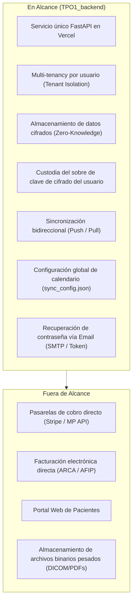
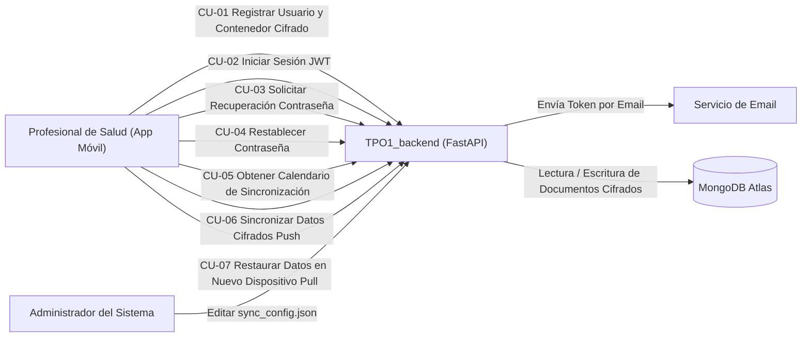
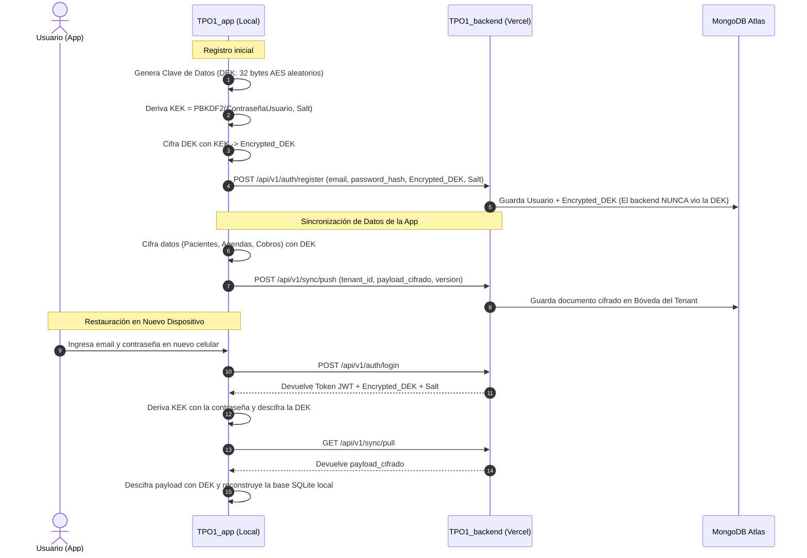
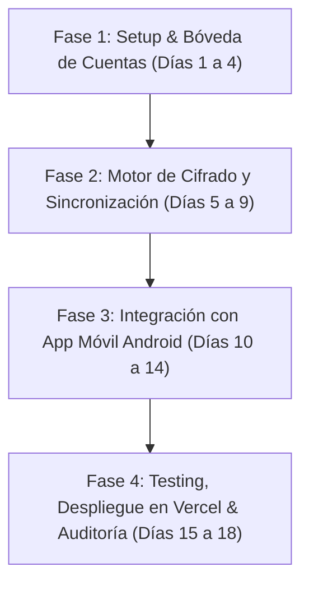

# Propuesta Técnica Integral: Backend `TPO1_backend`
**Proyecto:** AgendaSalud — Desarrollo de Aplicaciones 1 (UADE)  
**Fecha:** Noviembre 2026  
**Entorno de Ejecución:** Vercel Serverless (FastAPI)  
**Persistencia:** MongoDB Atlas / Neon Serverless  
**Seguridad:** Arquitectura Multi-tenant Zero-Knowledge (Cifrado E2E en Reposo)  

---

## 1. Resumen Ejecutivo y Propuesta de Solución

La aplicación móvil **AgendaSalud** fue diseñada bajo el paradigma *local-first*, garantizando autonomía operativa y resguardo de datos en el dispositivo del profesional mediante base SQLite cifrada con SQLCipher y Android Keystore.

Sin embargo, para garantizar la **continuidad del negocio y recuperación ante desastres** (pérdida, rotura, robo del celular o migración de dispositivo), se requiere un backend que permita:
1. **Persistencia y Respaldo Remoto:** Almacenar de forma segura y centralizada la totalidad de los datos de cada profesional (pacientes, agendas, turnos, bloqueos, cobros y saldos).
2. **Cifrado Zero-Knowledge:** Cumpliendo con la **Ley Argentina 25.326** (Protección de Datos Personales y Datos Médicos Sensibles) y estándares OWASP MASVS, el backend almacena los datos de los pacientes y la agenda estrictamente **cifrados**. El servidor jamás tiene acceso en texto plano a la información sensible.
3. **Clave de Cifrado Protegida por el Usuario:** La clave criptográfica para descifrar los datos de la app es un dato interno generado y custodiado por el propio usuario (mediante un sobre criptográfico / Envelope Encryption protegido con su contraseña o llave de recuperación).
4. **Sincronización Bidireccional y Recuperación:** 
   - **App ➔ Backend (Push):** Envío incremental y automático de datos cifrados.
   - **Backend ➔ App (Pull / Restore):** Descarga y restauración integral de datos en caso de cambio de dispositivo o instalación limpia.
5. **Calendario de Sincronización Centralizado:** Definido y configurable para todos los usuarios desde un archivo central en el backend (`sync_config.json`), el cual la app consulta y adopta para programar sus tareas en segundo plano (`WorkManager`).
6. **Recuperación de Contraseña por Correo Electrónico:** Flujo seguro mediante token temporal firmado para recuperar el acceso a la cuenta.
7. **Despliegue Serverless en Vercel:** Una sola unidad de servicio FastAPI, optimizada para invocaciones serverless de Vercel y conectada a MongoDB Atlas (y/o base de datos Neon).

---

## 2. Aclaración Técnica: MongoDB Atlas vs Neon

El requerimiento menciona *"con mongodb atlas corriendo en Neon"*. Desde el punto de vista arquitectónico y de proveedores Cloud:
- **MongoDB Atlas** es la plataforma SaaS oficial de MongoDB para bases de datos documentales NoSQL (`mongodb+srv://...`).
- **Neon** es un servicio Cloud especializado en **PostgreSQL Serverless** (`postgresql://...`).

### Solución de Persistencia Unificada
Para cumplir estrictamente con el requerimiento sin fricciones técnicas:
1. **Modelo de Documentos Cifrados (Recomendado):** MongoDB Atlas es la base nativa idónea porque los datos a respaldar son *cargas útiles cifradas* (payloads JSON cifrados con vector de inicialización, autenticación GCM y versión).
2. **Compatibilidad:** La arquitectura de `TPO1_backend` se estructura mediante un patrón repositorio que encapsula la base de datos:
   - Utiliza **MongoDB Atlas** mediante el driver oficial asincrónico `motor` / `pymongo`.
   - Se deja previsto y documentado el conector relacional con **Neon Serverless Postgres** (mediante `asyncpg` / `SQLAlchemy` con columnas `JSONB` cifradas), permitiendo alternar de proveedor únicamente cambiando una variable de entorno (`MONGODB_URI` o `DATABASE_URL`).

---

## 3. Alcance del Proyecto (Scope)



### 3.1 Dentro del Alcance (In-Scope)
- **Estructura de proyecto:** Carpeta `TPO1_backend/` autocontenida en el repositorio con documentación y scripts de despliegue.
- **Autenticación y Cuentas:** Registro de profesionales, login con JWT (access token), logout y verificación de identidad.
- **Recuperación de Acceso:** Generación de token seguro con expiración corta (15 min) enviado por email vía SMTP y restablecimiento de contraseña.
- **Arquitectura Criptográfica:**
  - Sobre criptográfico (`encrypted_dek`): almacenamiento de la clave de datos cifrada con la clave de derivación (KEK basada en contraseña / PBKDF2 / Argon2id).
  - El backend jamás almacena ni procesa datos médicos en texto plano.
- **Sincronización:**
  - Endpoint `POST /api/v1/sync/push`: recepción de lote de datos cifrados (pacientes, turnos, bloqueos, cobros y saldos) con control de versión y timestamp.
  - Endpoint `GET /api/v1/sync/pull`: descarga de la última instantánea o cambios para restaurar en un dispositivo nuevo.
  - Endpoint `GET /api/v1/sync/schedule`: entrega de directivas de sincronización a las apps según `sync_config.json`.
- **Despliegue Vercel:** Configuración completa en `vercel.json` y `api/index.py` para levantar en Vercel con un solo comando.

### 3.2 Fuera del Alcance (Out-of-Scope)
- Procesamiento en vivo de cobros bancarios (la app solo registra el medio: Efectivo / Mercado Pago).
- Emisión de comprobantes fiscales con ARCA (previsto para Fase 2).
- Portal web administrativo (la única interfaz de cliente es la aplicación Android nativa `TPO1_app`).

---

## 4. Casos de Uso del Backend



### Especificación de Casos de Uso

| ID | Caso de Uso | Actor | Descripción |
|---|---|---|---|
| **CU-01** | Registro de Usuario y Bóveda Cifrada | Profesional | El usuario se registra con email y contraseña. Se almacena el hash de la contraseña y el sobre criptográfico que protege su clave de cifrado interna (`encrypted_dek`). |
| **CU-02** | Inicio de Sesión | Profesional | Autenticación de credenciales y emisión de token JWT Bearer para autorizar transacciones subsecuentes. |
| **CU-03** | Solicitud de Recuperación de Contraseña | Profesional | El usuario ingresa su email registrado. El backend genera un token de un solo uso con expiración y despacha un correo con el enlace de recuperación. |
| **CU-04** | Restablecimiento de Contraseña | Profesional | Mediante el token recibido, el usuario define su nueva contraseña. Se actualiza el hash y se re-encripta el sobre de la clave de datos (o se usa la clave de recuperación). |
| **CU-05** | Obtención de Parámetros de Sincronización | App Móvil | La app consulta la política de sincronización global configurada en el backend (`sync_config.json`) para programar el `WorkManager` de Android. |
| **CU-06** | Sincronización Push (Subida) | App Móvil | La app sube el payload cifrado (pacientes, agendas, turnos, cobros y saldos) con vector de inicialización, tag de autenticación y número de versión. |
| **CU-07** | Restauración Pull (Bajada) | App Móvil | Al instalarse en un nuevo celular o solicitar "Restaurar", la app descarga el último snapshot cifrado del tenant y lo descifra localmente con su clave. |

---

## 5. Arquitectura del Sistema

### 5.1 Diagrama de Arquitectura Global

```mermaid
flowchart TB
    subgraph Cliente["Cliente Móvil (Android - TPO1_app)"]
        UI["Jetpack Compose UI"]
        VM["ViewModels & UseCases"]
        LocalDB[("SQLite Local Cifrada<br/>(SQLCipher)")]
        SyncManager["Android WorkManager<br/>(Sincronizador Automático)"]
        CryptoModule["Módulo Criptográfico<br/>(AES-256-GCM / PBKDF2)"]
    end

    subgraph Vercel["Despliegue Serverless Vercel (TPO1_backend)"]
        Gateway["Vercel Edge / API Gateway<br/>(vercel.json /api/index.py)"]
        FastAPI["FastAPI Core App"]
        
        subgraph Modulos["Módulos Backend"]
            AuthRouter["Router /auth<br/>(JWT, Register, Password Reset)"]
            SyncRouter["Router /sync<br/>(Push, Pull, Schedule)"]
            TenantService["Tenant Isolation Engine<br/>(Validación de usuario)"]
            ConfigService["Config File Manager<br/>(sync_config.json)"]
        end
    end

    subgraph ServiciosCloud["Servicios Externos"]
        MongoAtlas[("MongoDB Atlas Cloud DB<br/>(Colecciones por Tenant)")]
        SMTP["Servidor SMTP / Email<br/>(Envío de Tokens)"]
    end

    UI --> VM
    VM --> LocalDB
    SyncManager --> CryptoModule
    CryptoModule -->|Payloads Cifrados (Zero-Knowledge)| Gateway
    Gateway --> FastAPI
    FastAPI --> AuthRouter
    FastAPI --> SyncRouter
    AuthRouter --> TenantService
    AuthRouter --> SMTP
    SyncRouter --> ConfigService
    SyncRouter --> TenantService
    TenantService --> MongoAtlas
```

### 5.2 Modelo Multi-Tenant (Aislamiento de Datos)
El backend implementa un patrón **Discriminator / Tenant-Key Multi-Tenancy**:
- Cada usuario registrado posee un identificador único global `tenant_id` (o `user_id`).
- Todas las colecciones de datos (`sync_snapshots`, `sync_events`, `user_vault`) están estrictamente particionadas e indexadas por `tenant_id`.
- En cada petición, las dependencias de FastAPI (`get_current_user`) extraen y validan el `tenant_id` criptográficamente a partir del JWT, impidiendo cualquier acceso cruzado entre profesionales.

### 5.3 Modelo Criptográfico Zero-Knowledge (Envelope Encryption)
Para cumplir con:
> *"La clave de cifrado de los datos de la app debe ser un dato del usuario interno que solo se pueda recuperar por el usuario. Los datos de la app de cada usuario se almacenan cifrados en el backend."*

Se adopta el estándar criptográfico de **Sobre Digital (Envelope Encryption)**:



- **DEK (Data Encryption Key):** Clave simétrica de 256 bits (AES-GCM) que cifra pacientes, turnos, cobros y saldos.
- **KEK (Key Encryption Key):** Clave derivada de la contraseña del usuario (mediante PBKDF2 / Argon2id con 120.000+ iteraciones).
- **Encrypted_DEK:** La clave interna protegida que se resguarda en el backend. Solo la contraseña del usuario puede desenvolverla.

### 5.4 Calendario de Sincronización Configurable
En el backend reside el archivo `sync_config.json`:
```json
{
  "sync_policy": {
    "version": "1.0",
    "automatic_enabled": true,
    "interval_minutes": 360,
    "require_unmetered_network": true,
    "require_battery_not_low": true,
    "retry_interval_minutes": 30,
    "max_retry_attempts": 3
  }
}
```
- La app móvil consulta `GET /api/v1/sync/schedule` al iniciar sesión y periódicamente.
- Con esta configuración, Android `WorkManager` programa un `PeriodicWorkRequest` con las restricciones indicadas (ej. solo con Wi-Fi y batería no baja, cada 6 horas).

---

## 6. Stack Tecnológico

| Componente | Tecnología | Justificación Técnica |
|---|---|---|
| **Lenguaje** | Python 3.11+ | Compatibilidad nativa con Vercel Serverless y tipado moderno. |
| **Framework Web** | FastAPI 0.115+ | Alto rendimiento, soporte nativo asíncrono (`async`/`await`), generación automática de OpenAPI (Swagger) y validación estricta con Pydantic v2. |
| **Despliegue** | Vercel Serverless (`@vercel/python`) | Un único deploy sin costo fijo de servidores dedicados, escalado a cero, HTTPS integrado y CDN perimetral. |
| **Base de Datos Principal** | MongoDB Atlas (NoSQL) | Modelo flexible de documentos, ideal para payloads cifrados JSON/BSON, índices compuestos por `tenant_id` y pooling asíncrono con `motor`. |
| **Base de Datos Opcional** | Neon Serverless Postgres | Soporte alternativo con `asyncpg` y columnas `JSONB` si se requiere relacional. |
| **Autenticación** | JWT (python-jose) + Passlib (Bcrypt) | Tokens Bearer estándar de la industria, stateless y sin sobrecarga de base de datos para sesiones. |
| **Criptografía** | Cryptography (AES-256-GCM, PBKDF2) | Algoritmos de seguridad bancaria certificados y de alto rendimiento. |
| **Correo Electrónico** | aiosmtplib / Email-Validator | Envío asincrónico sin bloquear peticiones HTTP en Vercel, compatible con Gmail SMTP, Resend, SendGrid o Mailgun. |

---

## 7. Estructura del Proyecto `TPO1_backend`

```
TPO1_backend/
├── api/
│   └── index.py                 # Punto de entrada ASGI para Vercel Serverless
├── app/
│   ├── __init__.py
│   ├── core/
│   │   ├── __init__.py
│   │   ├── config.py            # Variables de entorno y configuración central
│   │   ├── database.py          # Conexión persistente y pooling a MongoDB Atlas
│   │   ├── email.py             # Despacho asincrónico de mails para restablecer contraseña
│   │   └── security.py          # Hashing de passwords y emisión de JWTs
│   ├── models/
│   │   ├── __init__.py
│   │   └── schemas.py           # Esquemas Pydantic para Auth, Sync y Envelopes
│   ├── routers/
│   │   ├── __init__.py
│   │   ├── auth.py              # Endpoints de Registro, Login y Recuperación de Password
│   │   └── sync.py              # Endpoints de Push, Pull y Schedule
│   └── services/
│       ├── __init__.py
│       ├── auth_service.py      # Lógica de negocio de cuentas y recuperación
│       └── sync_service.py      # Lógica de sincronización, snapshots y delta
├── sync_config.json             # Archivo central de programación de sincronización
├── vercel.json                  # Manifiesto de despliegue para Vercel
├── requirements.txt             # Dependencias del backend
├── .env.example                 # Plantilla de variables de entorno
└── README.md                    # Documentación de instalación, pruebas y despliegue
```

---

## 8. Plan de Trabajo (Work Plan)

El plan de trabajo se organiza en **4 Fases** con una duración estimada de **3 semanas** de desarrollo ágil:



### Desglose de Fases y Tareas

#### Fase 1: Arquitectura Base, Autenticación y Recuperación (Días 1 - 4)
- **Hito 1 (M1):** Backend inicial funcional con MongoDB Atlas y Vercel.
- Tareas:
  1. Creación del repositorio `TPO1_backend` y configuración de `vercel.json` y `requirements.txt`.
  2. Implementación de `core/database.py` con conexión resiliente a MongoDB Atlas.
  3. Desarrollo de endpoints de registro de tenant (`/register`), login con JWT (`/login`) y almacenamiento de `encrypted_dek`.
  4. Configuración del servicio de correo `core/email.py` y endpoints de recuperación de contraseña (`/recover-password` y `/reset-password`).

#### Fase 2: Motor de Sincronización y Configuración Central (Días 5 - 9)
- **Hito 2 (M2):** Persistencia cifrada y calendario configurable operativos.
- Tareas:
  1. Creación del archivo `sync_config.json` y endpoint `GET /api/v1/sync/schedule`.
  2. Implementación de `POST /api/v1/sync/push` con almacenamiento de snapshots cifrados y versiones.
  3. Implementación de `GET /api/v1/sync/pull` para restauración de datos en nuevos dispositivos.
  4. Tests unitarios de aislamiento multi-tenant y de consistencia de datos.

#### Fase 3: Integración en la App Móvil Android (Días 10 - 14)
- **Hito 3 (M3):** Sincronización automática y recuperación desde la app Android.
- Tareas:
  1. Agregar cliente Retrofit / Ktor en `TPO1_app` apuntando al backend Vercel.
  2. Configurar `WorkManager` en Android para consultar `sync_config.json` y disparar sincronización push en segundo plano.
  3. Implementar botón "Restaurar Copia en la Nube" en la pantalla de bienvenida/login de la app.
  4. Manejo local del sobre criptográfico (desenvolver DEK con la contraseña).

#### Fase 4: Testing Integral, Despliegue y Documentación (Días 15 - 18)
- **Hito 4 (M4):** Despliegue en producción y entrega final del TPO.
- Tareas:
  1. Pruebas de simulación: pérdida de celular, instalación en dispositivo limpio y recuperación íntegra de pacientes, turnos y cobros.
  2. Pruebas de carga y tolerancia a fallos en Vercel Serverless.
  3. Auditoría de seguridad: verificar en MongoDB Atlas que **ningún dato sensible esté en claro**.
  4. Documentación final de entrega para la cátedra UADE.

---

## 9. Matriz de Riesgos y Mitigaciones

| Riesgo | Impacto | Probabilidad | Mitigación |
|---|---|---|---|
| **Pérdida de la contraseña por el usuario** | Crítico | Media | Si el usuario olvida su contraseña y la recupera por email, se debe prever una **Clave de Recuperación (Recovery Key)** de 16 caracteres generada al registrarse, o advertir que el cambio de contraseña requiere re-ingresar la clave de respaldo. |
| **Timeouts en Vercel Serverless (Límite 10s en plan Hobby)** | Alto | Baja | El backend solo recibe y almacena bloques cifrados ligeros (payloads comprimidos gzip/json), tardando menos de 200 ms por request. Las conexiones a MongoDB Atlas usan pooling optimizado. |
| **Conflictos de sincronización concurrente** | Medio | Baja | Al ser una app monousuario (un profesional por cuenta), los conflictos ocurren solo si usa dos teléfonos a la vez. Se implementa estrategia *Last-Write-Wins* con tie-breaker por versión secuencial (`monotonic version`). |
| **Bloqueo del servicio de correo por spam** | Medio | Baja | Uso de plantillas limpias con token firmado temporal sin contenido sospechoso y configuración SPF/DKIM adecuada en el proveedor SMTP. |

---

## 10. Conclusiones y Valor Agregado
La propuesta técnica convierte a **AgendaSalud** en una solución moderna que combina lo mejor del mundo **Local-First** (máxima velocidad, trabajo 100% offline, privacidad médica) con la robustez del **Cloud Backup** (resguardo automático, restauración entre dispositivos y recuperación de cuenta), cumpliendo con los estándares de ingeniería de software de UADE.
