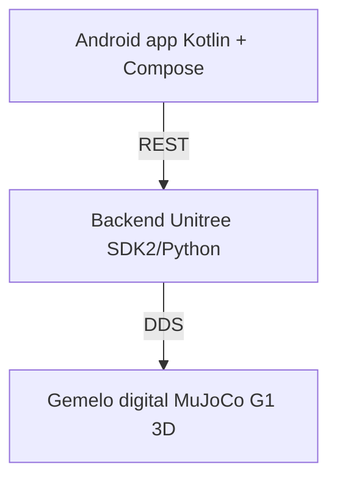

# DesarrolloAplicaciones1
Materia desarrollo de aplicaciones 1

> Repositorio de trabajo, documentación y trazabilidad de los TPO de la materia
> **Desarrollo de aplicaciones 1* — UADE — **2C 2026** — 

**Incluye docs y código fuente para cada TPO.** 

## TPO2_UnitreeG1

TPO obligatorio en donde utilicemos el robot de UADE Unitree G1 y realice tareas definidas. Tendremos que desarrollar y probar mediante el gemelo digital que se disponibiliza para dicho robot. 

La idea es separar el proyecto en dos partes: 
* Un backend desarrollado en VsCode para el control y/o simulación del Unitree G1 en una PC con Ubuntu + SDK2/MuJoCo
* Una app desarrollada en Android Studio que actúe como interfaz de mando y visualización del área. 

No tendremos todo junto en una app para Android, ya que esto sería muy pesado y dificil de implementar.

El robot G1 dispone de soporte en Unitree SDK2, incluyendo una API de locomoción de alto nivel para acciones como ponerse de pie, detenerse, caminar con velocidades vx, vy y rotación vyaw, y ejecutar acciones como saludar con la mano. El repositorio oficial incluye específicamente ejemplos para G1

### Definiciones generales

Se define un area con ancho, largo y un punto de partida, luego se debe mostrar un mapa con la ubicacion del rotot y se presenta una opción que permita moverlo hacia otra posición.  

Por ejemplo, se define un area y punto de partida: 
- Ancho: 6 metros
- Largo: 8 metros
- Punto de partida: (0,0)
- Movimiento X = 2 mt , Y = 5 mt

DDS = Data Distribution Service
REST= Representacion REpresentational State Transfer (Transferencia de Estado Representacional). Es un estilo de arquitectura que define un conjunto de reglas para crear servicios web sencillos.

### Ideas para TPO 2

## Idea A: Asistente Operativo para inspección y vigilancia
Objetivo: Un operador con la app Android navega el robot a puntos de interés para control, ejecuta patrullajes y supervisa alertas de telemetría.

Flujo: La app envía una ruta o un comando de inspección. El middleware coordina la marcha del Unitree G1 y transmite el video de la cámara de profundidad/cámara frontal junto con la batería y estado de los motores.

## Idea B: Sistema de guiado e interacción con Personas (Modo Recepcionista / Museo)
Objetivo: Utilizar el robot para dar la bienvenida a visitantes, realizar tours breves dentro de un recinto o guiarlos a un punto específico.
Componentes clave:
* Android App: Pantalla de selección de destinos (ej: "Ir a Sala A", "Ir a Oficina 3"), vista de estado actual de la guía ("Acompañando a visitante...") y chat/consola de voz.
* Backend Middleware: Gestiona las rutas predefinidas. Recibe la orden de Android, activa la navegación autonóma del G1, y emite eventos cuando llega a un punto para que Android reproduzca un texto explicativo (vía TTS de Android o parlante del robot).
* Aporte para la materia: Integración de comandos por voz, manejo de estados complejos en la App (Navegando $\rightarrow$ Esperando $\rightarrow$ Finalizado) y WebSockets bidireccionales.

## Idea C: Teleoperación Asistida por Visión y Reconocimiento de Objetos (Visión en Middleware)

Objetivo: Un operador utiliza la app de Android para indicarle al robot qué objeto inspeccionar o interactuar en un entorno mediante reconocimiento visual.

Componentes clave:
* Android App: Muestra el stream de video en tiempo real enviado por la cámara del robot. El usuario puede hacer tap sobre un área de la pantalla para seleccionar un objetivo.
* Backend Middleware: Corre un modelo ligero de visión (ej. YOLOv8 u OpenCV) sobre el stream de video. Al recibir la coordenada $(x, y)$ del tap de la app, el middleware calcula la posición del objeto respecto al robot y le envía al G1 la orden de orientarse o acercarse a esa posición.
* Aporte para la materia: Procesamiento de imágenes en backend, streaming de baja latencia (WebRTC/RTSP) hacia Android y cálculo de coordenadas relativas.

### Link a figma para diseño de los TPO

Link para TPO2_UnitreeG1

### Link a Trello para el seguimiento de las tareas requeridas

🗂️ **Tablero TPO2_UnitreeG1:** 

